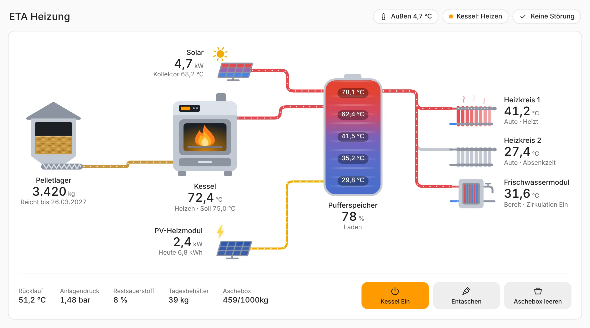
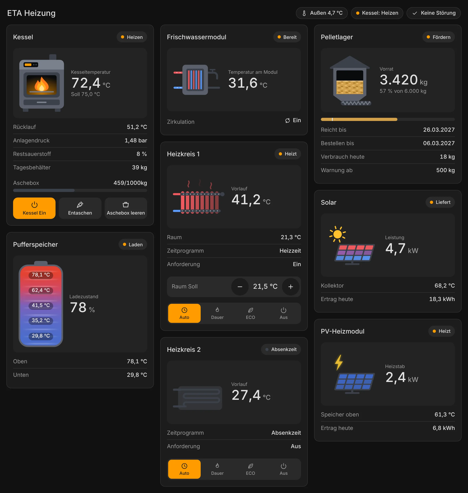
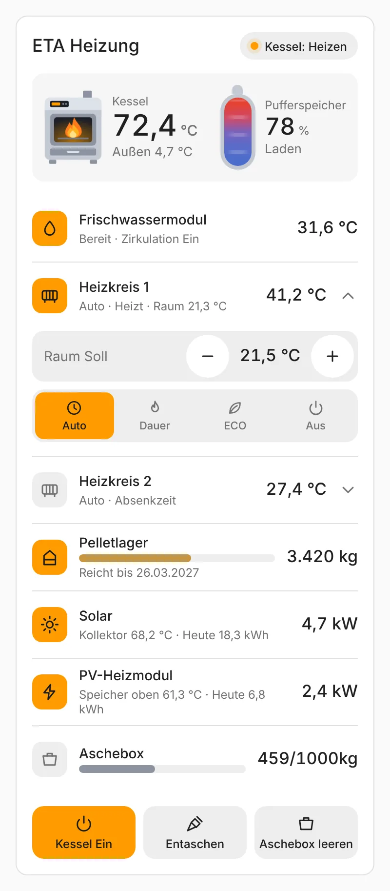
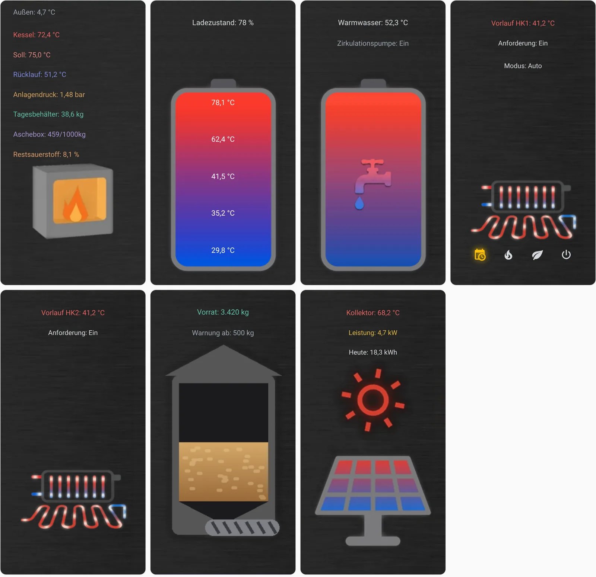
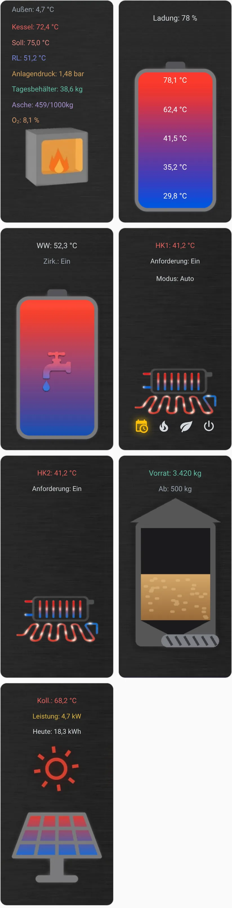
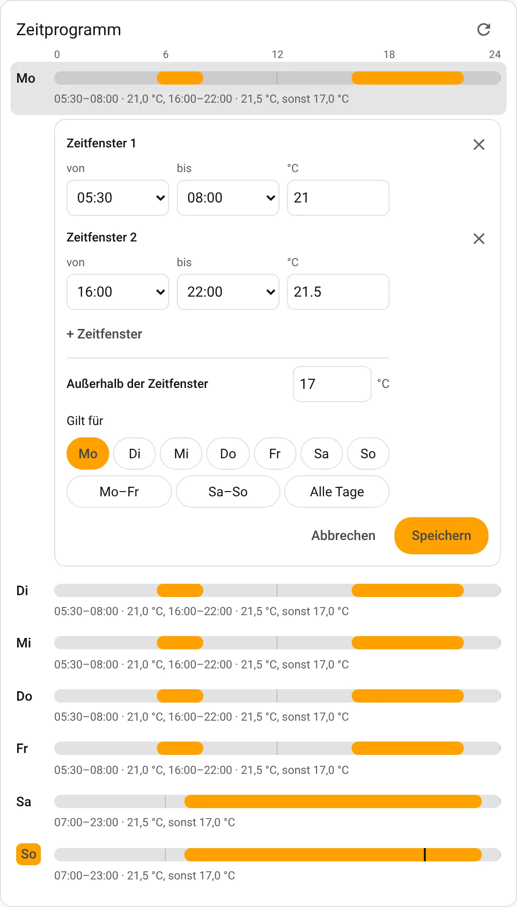
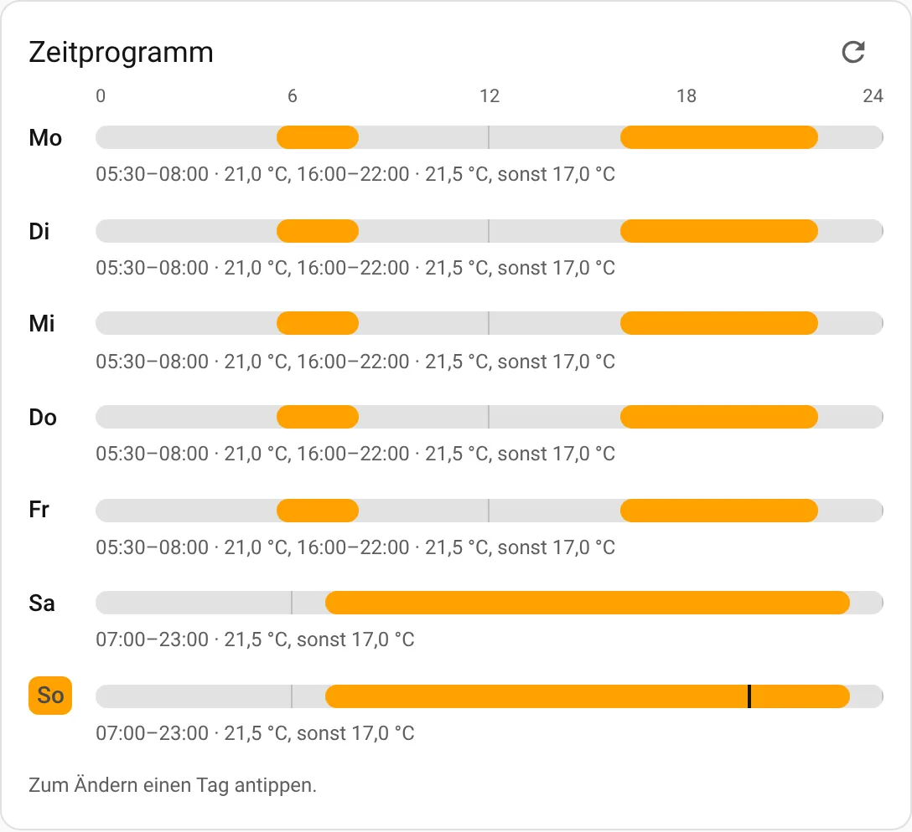

# ETA Web-Services für Home Assistant

[](https://github.com/hacs/integration)
[](https://github.com/dorsch95/ha-eta-webservices/releases)
[](LICENSE)

Bindet **ETA-Heizungen** über die eingebauten Webservices (ETAtouch) in Home Assistant ein: Pellet-, Hackgut- und Stückholzkessel samt Pufferspeichern, Warmwasser, Heizkreisen, Solaranlage, PV-Heizmodul, Pelletlager, zweitem Wärmeerzeuger und Fernleitung. Alles läuft lokal im Heimnetz, nichts geht ins Internet.

- **Einrichten ohne Adressen:** Du gibst an, was deine Anlage hat. Die Werte findet die Integration selbst im Menübaum der Heizung.
- **Fertige Dashboard-Karte:** eine Karte für alle Anlagen, mit eigenen Grafiken, für PC, Tablet und Handy.
- **Pelletverbrauch:** im Energie-Dashboard und je Tag, Woche und Jahr, auf Wunsch mit Kosten.
- **Verbrauchsprognose:** lernt aus deinem Verlauf und sagt, wann das Pelletlager leer ist.
- **Schalten nur auf Wunsch:** Ab Werk liest die Integration nur. Kesselschalter, Betriebsart, Thermostat, Zeitprogramm und Aschebox-Plan gibt es erst, wenn du den Schreibzugriff freigibst.

> ℹ️ Benötigt Home Assistant **2025.8** oder neuer.

**Inhalt:** [Vorbereitung](#-vorbereitung-an-der-heizung) · [Installation](#-installation) · [Einrichtung](#-einrichtung) · [Entitäten](#-entitäten) · [Dashboard-Karte](#-dashboard-karte) · [Was deine Anlage liefert](#-was-deine-anlage-liefert) · [Verbrauch und Energie-Dashboard](#-verbrauch-kosten-und-energie-dashboard) · [Prognose](#-verbrauchsprognose-und-reichweite-des-lagers) · [Schalten und Einstellen](#-schalten-und-einstellen) · [Störungen](#-störungen) · [Blueprints](#-blueprints) · [Fehlersuche](#-fehlersuche)

## 👀 So sieht es aus



<p>


</p>

Die Karte [ETA Übersicht](#neue-karte-eta-übersicht): oben als Anlagenbild, darunter als Kacheln im dunklen Design und kompakt am Handy. Die Werte sind Beispiele.



<p>


</p>

Darüber die bisherige [Dashboard-Karte](#-dashboard-karte) am PC, darunter am Handy und die Karte [ETA Zeitprogramm](#zeitprogramm-auf-dem-dashboard) mit einem geöffneten Tag. Die Werte stammen von einer nachgebauten Testanlage.

<details>
<summary>🇬🇧 <b>English summary</b></summary>

**ETA Web-Services** reads ETA heating systems (pellet, wood chip and log boilers with up to eight buffer tanks, up to eight fresh water modules or hot water tanks, heating circuits, solar, PV heating module, pellet store, a second heat source and a transfer line to another building) **entirely locally** via the ETAtouch RESTful webservices built into the boiler. Nothing goes to the internet. Read-only by default; switching the boiler and heating circuit modes has to be enabled explicitly.

- Install via HACS, restart, then **Settings → Devices & services → Add integration → ETA Web-Services**. Enter the boiler's IP address (port 8080), the number of buffer tanks, hot water units and heating circuits, and tick the other components your system has. The function block names are then pre-filled with what your system reports. A log boiler with pellet unit (SH TWIN) also ticks *TWIN*.
- Values are found by their **names** in the boiler's menu tree, not by fixed addresses. The search uses the German menu names, which is what practically all systems in Germany, Austria and Switzerland report. If a name doesn't match, measured values are also found by the object's number inside its function block - so with a different display language, enter your function block names as your display shows them. Buttons and switches are only found by name.
- Entity IDs are the same in every Home Assistant language (e.g. `sensor.eta_heizung_kesseltemperatur`), so the dashboard card works everywhere. Display names are translated.
- With switching enabled, the card **ETA Zeitprogramm** shows each heating circuit's time program as weekly bars and lets you change it right on the dashboard: tap a day, adjust up to 3 time slots, apply them to other days, save. Buffer loading times and hot water times can be shown too (*Show* in the card editor); hot water temperatures are editable from 0 to 80 °C, buffer loading times only switch loading on and off. Home Assistant loads the card by itself - add it via *Edit dashboard → Add card*.
- Alternatively, a heating circuit's time program can follow a Home Assistant **schedule helper**: each block becomes one of the system's time windows (at most 3 per day, quarter hours); a temperature is only written if a block carries `temperature` in its additional data.
- A **self-learning forecast** learns from Home Assistant's long-term statistics how many pellets the house burns at which outside temperature. It predicts tomorrow's consumption and the day the pellet store runs empty or reaches its warning level, optionally using a weather entity's forecast.
- The card **ETA Overview** needs no YAML: add it like any other card and pick a view - tiles, a system diagram with pipes, or a compact list. It adapts to your system, follows the light or dark theme and animates whatever is working. With several buffer tanks or a transfer line, the options dialog asks which part feeds which. The order of the parts can be dragged in the card settings.
- The earlier ready-made dashboard card stays available: **Developer tools → Actions → "ETA Web-Services: Create dashboard card"**, then paste the response as a manual card in a *Panel* view.
- Problems or a system that reports different values: open an [issue](https://github.com/dorsch95/ha-eta-webservices/issues/new/choose) and attach the **diagnostics file** (device page → *Download diagnostics*). It contains the complete menu tree, the IP address is redacted.

</details>

---

## 🔧 Vorbereitung an der Heizung

Die Webservices müssen an der Steuerung einmal eingeschaltet werden:

1. Auf der Anlage läuft **Systemsoftware x.20.0 oder neuer**.
2. Die Anlage ist bei [meinETA](https://meineta.at) registriert.
3. Am Touch-Display unten links den **Werkzeugkasten** öffnen, dann **Internet & Schnittstellen → meinETA Zugang**.
4. Dort die **Webservices** aktivieren.

Zur Probe im Browser `http://<IP-der-Heizung>:8080/user/menu` öffnen. Erscheint eine XML-Seite mit dem Menübaum deiner Anlage, ist alles bereit.

## 🚀 Installation

[](https://my.home-assistant.io/redirect/hacs_repository/?owner=dorsch95&repository=ha-eta-webservices&category=integration)

Der Knopf öffnet die Integration direkt in HACS. Von Hand geht es so:

1. **HACS** öffnen, nach **ETA Web-Services** suchen und **Herunterladen**.
2. Home Assistant neu starten.

Die Integration steht im Standard-Store von HACS, ein benutzerdefiniertes Repository ist nicht nötig.

## 🧭 Einrichtung

Unter **Einstellungen → Geräte & Dienste → Integration hinzufügen** die Integration **ETA Web-Services** wählen. Der Dialog führt durch diese Schritte.

**1. Verbindung und Anlage**

| Feld | Vorgabe | Bedeutung |
|---|---|---|
| IP-Adresse, Port | `8080` | Adresse der Heizung im Heimnetz |
| Pufferspeicher | 1 | Anzahl, PufferFlex und ältere Puffer zusammen, bis 8 |
| Frischwassermodule und Warmwasserspeicher | 0 | Anzahl zusammen, bis 8 |
| Heizkreise | 0 | Anzahl, bis 4 |
| Weitere Komponenten | keine | Solaranlage, Pelletlager, PV-Heizmodul, Brenner, Fernleitung, TWIN. Was dahintersteckt, steht unter [Was deine Anlage liefert](#-was-deine-anlage-liefert) |
| Abfrageintervall | 30 Sekunden | erlaubt sind 1 bis 600. Die Integration liest alle Messwerte mit einer einzigen Anfrage. Je kürzer, desto öfter muss die Anlage antworten - bei wenigen Sekunden die Auslastung am Display der Anlage im Auge behalten. Die Störungsliste wird dann nur alle 10 Sekunden gelesen |
| Schnelle Abfrage | 3 Sekunden | 0 = aus. Liest eine kleine Gruppe öfter als den Rest: alles Schaltbare (Kessel ein/aus, Entaschen, Betriebsart und Raum Soll der Heizkreise), den Kessel-Zustand, die Raumtemperatur und am Frischwassermodul Durchfluss, Drehzahl der Pufferpumpe und Zirkulation. So zeigt das Dashboard etwa das Zapfen ohne Verzug. Wirkt nur, wenn der Wert kleiner ist als das Abfrageintervall |
| Heizwert der Pellets | 4,8 kWh/kg | Richtwert für ENplus A1. Steht auf dem Lieferschein ein anderer Wert, trag ihn ein |
| Pelletpreis | 0 | in Euro je Tonne. Mit einem Preis rechnet die Integration auch die Kosten aus |
| Störungsmeldungen auslesen | an | siehe [Störungen](#-störungen) |
| Kessel und Heizkreise schalten dürfen | aus | der Schreibzugriff, siehe [Schalten und Einstellen](#-schalten-und-einstellen) |
| Pelletverbrauch je Zeitraum | an | heute, Woche und Jahr |
| Pelletprognose und Reichweite des Lagers | an | siehe [Verbrauchsprognose](#-verbrauchsprognose-und-reichweite-des-lagers) |
| Wettervorhersage | automatisch | für die Prognose. Gibt es genau eine Wetter-Entität, ist sie vorausgewählt |

Den Kessel hat jede Anlage, er steht deshalb nicht zur Wahl. Wer nur die Messwerte braucht, wählt Verbrauch je Zeitraum und Prognose ab und bekommt entsprechend weniger Entitäten. Schaltest du den Schreibzugriff ein, folgt ein Hinweis, den du bestätigst.

**2. Funktionsblock-Namen bestätigen**

Die Felder sind mit den Namen vorausgefüllt, die deine Anlage meldet. Ändern musst du sie nur, wenn die Vorbelegung nicht passt, siehe [Funktionsblock-Namen](#funktionsblock-namen).

**3. Pufferspeicher-Volumen**

Der Schritt erscheint nur beim älteren Funktionsblock „Puffer“. Er zeigt sein effektives Volumen am Display, gibt es aber nicht an die Webservices weiter. Trag die Liter vom Display, vom Typenschild oder aus den Unterlagen ein. Beim PufferFlex liest die Integration das Volumen selbst.

**4. und 5. Raumfühler und Zeitprogramm aus Home Assistant**

Beide Schritte erscheinen nur mit Schreibzugriff und passender Anlage, siehe [Thermostat und Raumfühler](#thermostat-und-raumfühler-aus-home-assistant) und [Zeitprogramm aus Home Assistant](#zeitprogramm-aus-home-assistant).

Alle Einstellungen lassen sich später unter **Einstellungen → Geräte & Dienste → ETA Web-Services → Konfigurieren** ändern. Nur die IP-Adresse steht woanders: im Drei-Punkte-Menü der Integration unter **Neu konfigurieren**.

### Funktionsblock-Namen

Jeder Funktionsblock (FUB) lässt sich an der Steuerung umbenennen und heißt dann auch in den Webservices anders. Die Integration belegt die Felder deshalb mit den Namen vor, die deine Anlage meldet: Pufferspeicher bekommen der Reihe nach erst die PufferFlex, dann die älteren Puffer, Warmwasser erst die FWM, dann die WW. Antwortet die Anlage nicht, stehen dort die Standardnamen:

| Komponente | Standardname |
|---|---|
| Kessel | `Kessel` |
| Pelletteil des SH TWIN | `Twin` |
| Pufferspeicher | `PufferFlex`, bei älteren Anlagen `Puffer`. Weitere heißen `PufferFlex 2` oder `Puffer 2` und so fort bis 8 |
| Frischwassermodul, Warmwasserspeicher | `FWM` oder `WW`. Weitere heißen `FWM 2` oder `WW 2` und so fort bis 8 |
| Heizkreis 1 bis 4 | `HK` (auch `HK1` oder `HK 1`), `HK2`, `HK3`, `HK4` |
| Pelletlager | `Lager` |
| Solaranlage | `Solar` |
| PV-Heizmodul | `PVM` |
| Brenner | `Brenner` |
| Fernleitung | `Fernl` |
| Außentemperatur | `Sys` |

Liegt ein Funktionsblock auf einem Zusatzmodul, hängt ETA oft Modul- und laufende Nummer an, etwa `HK 1.1` oder `WW 1.1`. Solche Namen und alle selbst vergebenen (etwa „Fußboden“ statt `HK2`) trägst du hier ein. Den genauen Namen zeigt das Display der Heizung als Reiter über dem Funktionsblock.

---

## 📊 Entitäten

Alle Entitäten gehören zum Gerät **ETA Heizung**. Drei Regeln gelten überall:

- **Nur gewählte Komponenten** bekommen Entitäten.
- **Jeder Sensor einer Komponente ist immer da.** Führt deine Anlage den Wert nicht, zeigt er `-`. So bleiben Dashboards, Automatisierungen und Statistiken auf jeder Anlage gleich. Nur wenige Werte entstehen erst, wenn die Anlage sie hat, etwa das effektive Puffervolumen, die Ladepumpe oder die Raumtemperatur eines Heizkreises.
- **Die Entitäts-IDs sind in jeder Sprache gleich.** Die Kesseltemperatur heißt auch in einem englischen Home Assistant `sensor.eta_heizung_kesseltemperatur`, nur der angezeigte Name ist übersetzt.

Was eine Erklärung braucht:

- **Pufferfühler:** so viele, wie die Anlage hat. PufferFlex hat 3 bis 9, der ältere Funktionsblock „Puffer“ 2 bis 5. Fühler 1 trägt das Attribut `position: oben`, der letzte `position: unten`.
- **Effektives Puffervolumen:** Die Regelung errechnet es aus Gesamtvolumen und Lage der Fühler. PufferFlex meldet es, beim älteren „Puffer“ trägst du es beim Einrichten ein. Damit rechnen der Energieinhalt und die Prognose.
- **Ladezustand** gibt es nur beim PufferFlex, eine **Ladepumpe** nur bei einem Puffer, der im ETA-Assistenten als dezentral geladen eingerichtet ist.
- **Weitere Speicher:** Pufferspeicher 2 bis 8 bringen Fühler, Zustand, Ladezustand, Volumen und Ladepumpe mit, Warmwasser 2 bis 8 die Temperatur und die Zirkulationspumpe. Den Energieinhalt gibt es nur für den ersten Puffer.
- **Pumpen** (Zirkulation, Ladepumpe, Pufferpumpe, Fernleitung) melden `Ein` oder `Aus`, also ob sie gerade laufen.
- **Warmwasser:** Der **Zustand** sagt beim Warmwasserspeicher, ob er lädt. Seine **Ladepumpe** läuft, solange dafür Wärme fließt. Das Frischwassermodul hat stattdessen eine **Pufferpumpe**: Sie läuft, solange es Wasser erwärmt, also beim Zapfen und bei laufender Zirkulation. Ihre Anforderung bleibt nach dem Zapfen noch stehen; ob gerade wirklich Wasser fließt, zeigen der **Durchfluss** und die **Drehzahl** der Pufferpumpe. Deren Einheit übernimmt die Integration von der Anlage. Jeden dieser Werte gibt es nur, wenn deine Anlage ihn führt.
- **Kombispeicher:** Ist im Pufferspeicher ein Warmwasserbereich eingerichtet, gibt es dessen Temperatur als **Puffer Warmwasser**, beim älteren Funktionsblock „Puffer“ dazu den Zustand. Ohne Kombispeicher entstehen beide nicht.
- **`sensor.eta_heizung_aschebox_status`** fasst Verbrauch und Schwelle in einem Text zusammen („459/1000kg“), weil die Dashboard-Karte zwei Werte nicht zusammenführen kann.
- **Komponenten-Marker** (Diagnose): je Komponente eine Entität, an der die Dashboard-Karte erkennt, was vorhanden ist.
- **Schalter, Betriebsart, Thermostat und Knöpfe** entstehen nur mit Schreibzugriff, siehe [Schalten und Einstellen](#-schalten-und-einstellen).

<details>
<summary><b>Alle Entitäten im Überblick</b> (aufklappen)</summary>

| Entität | Bedeutung | Einheit |
|---|---|---|
| **Kessel** | | |
| `sensor.eta_heizung_aschebox_leeren_nach` | Aschebox Leeren nach | kg |
| `sensor.eta_heizung_aschebox_verbrauch_seit_leerung` | Aschebox Verbrauch seit Leerung | kg |
| `sensor.eta_heizung_aussentemperatur` | Außentemperatur | °C |
| `sensor.eta_heizung_kessel_solltemperatur` | Kessel Solltemperatur | °C |
| `sensor.eta_heizung_kessel_zustand` | Kessel Zustand | Text |
| `sensor.eta_heizung_kesseldruck` | Kesseldruck | bar |
| `sensor.eta_heizung_kesseltemperatur` | Kesseltemperatur | °C |
| `sensor.eta_heizung_pellet_gesamtverbrauch` | Pellet Gesamtverbrauch | kg |
| `sensor.eta_heizung_pelletverbrauch_heute` | Pelletverbrauch seit Mitternacht | kg |
| `sensor.eta_heizung_pelletverbrauch_diese_woche` | Pelletverbrauch seit Montag | kg |
| `sensor.eta_heizung_pelletverbrauch_dieses_jahr` | Pelletverbrauch seit 1. Januar | kg |
| `sensor.eta_heizung_pelletkosten_heute` … `_diese_woche`, `_dieses_jahr` | Kosten dazu, nur mit eingetragenem Pelletpreis | EUR |
| `sensor.eta_heizung_pellet_inhalt_tagesbehalter` | Pellet Inhalt Tagesbehälter | kg |
| `sensor.eta_heizung_pelletprognose_morgen` | Erwarteter Verbrauch morgen | kg |
| `sensor.eta_heizung_pelletprognose_treffsicherheit` | Wie gut die Prognose die letzten 14 Tage getroffen hat | % |
| `sensor.eta_heizung_pelletprognose_status` | Was die Prognose gerade tut („lernt noch“, „bereit“) | Text |
| `sensor.eta_heizung_restsauerstoff` | Restsauerstoff | % |
| `sensor.eta_heizung_rucklauftemperatur` | Rücklauftemperatur | °C |
| `sensor.eta_heizung_verbrauch_seit_entaschung` | Verbrauch seit Entaschung | kg |
| `switch.eta_heizung_kessel` | Kessel | Schalter |
| `button.eta_heizung_kessel_entaschen` | Kessel entaschen | Knopf |
| `datetime.eta_heizung_aschebox_leeren_um` | Aschebox leeren um, startet den Aschebox-Plan | Datum/Uhrzeit |
| `sensor.eta_heizung_aschebox_plan` | Schritt des Aschebox-Plans | Text |
| `button.eta_heizung_aschebox_plan_abbrechen` | Aschebox-Plan abbrechen | Knopf |
| **Pufferspeicher** | | |
| `sensor.eta_heizung_puffer_ladezustand` | Puffer Ladezustand | % |
| `sensor.eta_heizung_puffer_zustand` | Puffer Zustand | Text |
| `sensor.eta_heizung_puffer_effektives_volumen` | Puffer effektives Volumen | L |
| `sensor.eta_heizung_puffer_ladepumpe` | Puffer Ladepumpe | Text |
| `sensor.eta_heizung_puffer_warmwasser` | Puffer Warmwasser | °C |
| `sensor.eta_heizung_puffer_warmwasser_zustand` | Puffer Warmwasser Zustand | Text |
| `sensor.eta_heizung_puffer_energieinhalt` | Wärme im Puffer über 30 °C, nur mit bekanntem Volumen | kWh |
| `sensor.eta_heizung_puffer_fuhler_1` … `_9` | je vorhandenem Pufferfühler einer | °C |
| **Pufferspeicher 2 bis 8** (hier für Nummer 2, die weiteren heißen genauso mit ihrer Nummer) | | |
| `sensor.eta_heizung_puffer_2_zustand` | Puffer 2 Zustand | Text |
| `sensor.eta_heizung_puffer_2_ladezustand` | Puffer 2 Ladezustand | % |
| `sensor.eta_heizung_puffer_2_effektives_volumen` | Puffer 2 effektives Volumen | L |
| `sensor.eta_heizung_puffer_2_ladepumpe` | Puffer 2 Ladepumpe | Text |
| `sensor.eta_heizung_puffer_2_warmwasser` | Puffer 2 Warmwasser | °C |
| `sensor.eta_heizung_puffer_2_warmwasser_zustand` | Puffer 2 Warmwasser Zustand | Text |
| `sensor.eta_heizung_puffer_2_fuhler_1` … `_9` | je vorhandenem Pufferfühler einer | °C |
| **FWM** (erstes Frischwassermodul oder erster Warmwasserspeicher) | | |
| `sensor.eta_heizung_fwm_warmwassertemperatur` | FWM Warmwassertemperatur | °C |
| `sensor.eta_heizung_fwm_zirkulationspumpe` | FWM Zirkulationspumpe | Text |
| `sensor.eta_heizung_fwm_zustand` | FWM Zustand | Text |
| `sensor.eta_heizung_fwm_ladepumpe` | FWM Ladepumpe | Text |
| `sensor.eta_heizung_fwm_pufferpumpe` | FWM Pufferpumpe | Text |
| `sensor.eta_heizung_fwm_durchfluss` | FWM Durchfluss | von der Anlage |
| `sensor.eta_heizung_fwm_pufferpumpe_drehzahl` | FWM Pufferpumpe Drehzahl | von der Anlage |
| **Warmwasser 2 bis 8** (hier für Nummer 2, die weiteren heißen genauso mit ihrer Nummer) | | |
| `sensor.eta_heizung_warmwasser_2_temperatur` | Warmwasser 2 Temperatur | °C |
| `sensor.eta_heizung_warmwasser_2_zirkulationspumpe` | Warmwasser 2 Zirkulationspumpe | Text |
| `sensor.eta_heizung_warmwasser_2_zustand` | Warmwasser 2 Zustand | Text |
| `sensor.eta_heizung_warmwasser_2_ladepumpe` | Warmwasser 2 Ladepumpe | Text |
| `sensor.eta_heizung_warmwasser_2_pufferpumpe` | Warmwasser 2 Pufferpumpe | Text |
| `sensor.eta_heizung_warmwasser_2_durchfluss` | Warmwasser 2 Durchfluss | von der Anlage |
| `sensor.eta_heizung_warmwasser_2_pufferpumpe_drehzahl` | Warmwasser 2 Pufferpumpe Drehzahl | von der Anlage |
| **Heizkreis 1** | | |
| `select.eta_heizung_heizkreis_1_betriebsart` | Heizkreis 1 Betriebsart | Auswahl |
| `sensor.eta_heizung_heizkreis_anforderung` | Heizkreis Anforderung | Text |
| `sensor.eta_heizung_heizkreis_vorlauftemperatur` | Heizkreis Vorlauftemperatur | °C |
| `sensor.eta_heizung_heizkreis_raumtemperatur` | Heizkreis Raumtemperatur | °C |
| `sensor.eta_heizung_heizkreis_zeitprogramm` | Heizkreis Zeitprogramm | Text |
| `climate.eta_heizung_heizkreis_1_thermostat` | Heizkreis 1 Thermostat | Thermostat |
| **Heizkreis 2** | | |
| `select.eta_heizung_heizkreis_2_betriebsart` | Heizkreis 2 Betriebsart | Auswahl |
| `sensor.eta_heizung_heizkreis_2_anforderung` | Heizkreis 2 Anforderung | Text |
| `sensor.eta_heizung_heizkreis_2_vorlauftemperatur` | Heizkreis 2 Vorlauftemperatur | °C |
| `sensor.eta_heizung_heizkreis_2_raumtemperatur` | Heizkreis 2 Raumtemperatur | °C |
| `sensor.eta_heizung_heizkreis_2_zeitprogramm` | Heizkreis 2 Zeitprogramm | Text |
| `climate.eta_heizung_heizkreis_2_thermostat` | Heizkreis 2 Thermostat | Thermostat |
| **Heizkreis 3** | | |
| `select.eta_heizung_heizkreis_3_betriebsart` | Heizkreis 3 Betriebsart | Auswahl |
| `sensor.eta_heizung_heizkreis_3_anforderung` | Heizkreis 3 Anforderung | Text |
| `sensor.eta_heizung_heizkreis_3_vorlauftemperatur` | Heizkreis 3 Vorlauftemperatur | °C |
| `sensor.eta_heizung_heizkreis_3_raumtemperatur` | Heizkreis 3 Raumtemperatur | °C |
| `sensor.eta_heizung_heizkreis_3_zeitprogramm` | Heizkreis 3 Zeitprogramm | Text |
| `climate.eta_heizung_heizkreis_3_thermostat` | Heizkreis 3 Thermostat | Thermostat |
| **Heizkreis 4** | | |
| `select.eta_heizung_heizkreis_4_betriebsart` | Heizkreis 4 Betriebsart | Auswahl |
| `sensor.eta_heizung_heizkreis_4_anforderung` | Heizkreis 4 Anforderung | Text |
| `sensor.eta_heizung_heizkreis_4_vorlauftemperatur` | Heizkreis 4 Vorlauftemperatur | °C |
| `sensor.eta_heizung_heizkreis_4_raumtemperatur` | Heizkreis 4 Raumtemperatur | °C |
| `sensor.eta_heizung_heizkreis_4_zeitprogramm` | Heizkreis 4 Zeitprogramm | Text |
| `climate.eta_heizung_heizkreis_4_thermostat` | Heizkreis 4 Thermostat | Thermostat |
| **Pelletlager** | | |
| `sensor.eta_heizung_lager_austragung` | Lager Austragung | Text |
| `sensor.eta_heizung_lager_fassungsvermogen` | Lager Fassungsvermögen | kg |
| `sensor.eta_heizung_lager_fullstand` | Lager Füllstand (Vorrat geteilt durch maximalen Vorrat) | % |
| `sensor.eta_heizung_lager_reicht_bis` | Tag, an dem das Lager voraussichtlich leer ist | Datum |
| `sensor.eta_heizung_lager_bestellen_bis` | Tag, an dem voraussichtlich die Warngrenze erreicht ist | Datum |
| `sensor.eta_heizung_lager_reichweite` | Tage, bis das Lager voraussichtlich leer ist | d |
| `sensor.eta_heizung_lager_vorrat` | Lager Vorrat | kg |
| `sensor.eta_heizung_lager_warngrenze` | Lager Warngrenze | kg |
| **Solar** | | |
| `sensor.eta_heizung_solar_ertrag_gestern` | Solar Ertrag gestern | kWh |
| `sensor.eta_heizung_solar_ertrag_heute` | Solar Ertrag heute | kWh |
| `sensor.eta_heizung_solar_kollektortemperatur` | Solar Kollektortemperatur | °C |
| `sensor.eta_heizung_solar_leistung` | Solar Leistung | kW |
| `sensor.eta_heizung_solar_warmemenge` | Solar Wärmemenge | kWh |
| **PV-Heizmodul** | | |
| `sensor.eta_heizung_pv_heizmodul_ertrag_gestern` | PV-Heizmodul Ertrag gestern | kWh |
| `sensor.eta_heizung_pv_heizmodul_ertrag_heute` | PV-Heizmodul Ertrag heute | kWh |
| `sensor.eta_heizung_pv_heizmodul_gesamtenergie` | PV-Heizmodul Gesamtenergie | kWh |
| `sensor.eta_heizung_pv_heizmodul_heizstab` | PV-Heizmodul Heizstab | kW |
| `sensor.eta_heizung_pv_heizmodul_temperatur_mitte` | PV-Heizmodul Temperatur Mitte | °C |
| `sensor.eta_heizung_pv_heizmodul_temperatur_oben` | PV-Heizmodul Temperatur oben | °C |
| `sensor.eta_heizung_pv_heizmodul_temperatur_unten` | PV-Heizmodul Temperatur unten | °C |
| `sensor.eta_heizung_pv_heizmodul_zustand` | PV-Heizmodul Zustand | Text |
| **Brenner** | | |
| `sensor.eta_heizung_brenner_anforderung` | Brenner Anforderung | Text |
| `sensor.eta_heizung_brenner_temperatur` | Brenner Temperatur | °C |
| `sensor.eta_heizung_brenner_leistung_soll` | Brenner Leistung Soll | kW |
| `sensor.eta_heizung_brenner_volllaststunden` | Brenner Volllaststunden | h |
| **Fernleitung** | | |
| `sensor.eta_heizung_fernleitung_pumpe` | Fernleitung Pumpe | Text |
| **Unabhängig von den Komponenten** | | |
| `sensor.eta_heizung_aschebox_status` | „459/1000kg“ für die Dashboard-Anzeige | Text |
| `sensor.eta_heizung_pellet_energieverbrauch_gesamt` | Gesamtverbrauch als Energie fürs Energie-Dashboard | kWh |
| `sensor.eta_heizung_aktive_fehler` | Anzahl der anstehenden Störungen | |
| `sensor.eta_heizung_komponente_*` | Marker je Komponente für die Dashboard-Karte | |
| `binary_sensor.eta_heizung_storung` | an, sobald eine Störung ansteht | |
| `binary_sensor.eta_heizung_aschebox_leeren` | an, sobald die Schwelle erreicht ist | |
| `binary_sensor.eta_heizung_pelletvorrat_niedrig` | an, sobald der Vorrat die Warngrenze erreicht | |
| `switch.eta_heizung_animationen` | bewegte oder stehende Bilder auf der Dashboard-Karte | Schalter |

</details>

### Fehlt ein Wert dauerhaft oder nur gerade?

Das sagt das Attribut `status` jedes Sensors:

| `status` | Anzeige | Bedeutung |
|---|---|---|
| `ok` | der Wert | alles in Ordnung |
| `nicht_vorhanden` | `-` | stand schon beim Einrichten nicht im Menübaum, die Anlage hat den Wert nicht |
| `nicht_erreichbar` | *Nicht verfügbar* | den Wert gibt es, er kam bei den letzten Abfragen aber nicht an |
| `kein_messwert` | *Unbekannt* | die Anlage zeigt nur `---`, meist ein Fühler mit Unterbrechung oder Kurzschluss |

Ein einzelner Aussetzer ändert nichts, der letzte Wert bleibt stehen. Erst wenn ein Wert zweimal hintereinander ausbleibt, gilt der Sensor als nicht erreichbar. In einer Automatisierung:

```jinja2
{{ state_attr('sensor.eta_heizung_kesseldruck', 'status') == 'nicht_vorhanden' }}
```

---

## 📺 Dashboard-Karte

Eine Karte für alle Anlagen. Sie zeigt die Komponenten, die du gewählt hast, und passt sich an PC, Tablet und Handy an. Die Grafiken bringt die Integration mit.

### Einrichten

1. **Entwicklerwerkzeuge → Aktionen** öffnen, **ETA Web-Services: Dashboard-Karte erzeugen** wählen und **Aktion ausführen**. Die Antwort ist die fertige Karte, zugeschnitten auf deine Anlage. Kopiere sie komplett.
2. Im Dashboard eine **neue Ansicht** anlegen (Stift oben rechts, dann `+`) und als Layout **Panel (einzelne Karte)** wählen. In der normalen Ansicht begrenzt Home Assistant Karten auf etwa 500 Pixel Breite, die Beschriftungen würden abgeschnitten.
3. Eine Karte vom Typ **Manuell** einfügen und den Inhalt durch die kopierte Antwort ersetzen.

Baust du deine Anlage um oder benennst eine Entität um, führ die Aktion einfach noch einmal aus.

Alternativ gibt es die **universelle Karte** [dashboard/eta-karte.yaml](dashboard/eta-karte.yaml), die ohne Aktion zu fast jeder Anlage passt. Sie ist deutlich länger, weil sie alle Komponenten enthält und das Passende per Bedingung einblendet, und zeigt bis zu drei Pufferspeicher und drei Warmwasser. Hast du mehr, nimm die Aktion.

### Was die Kacheln zeigen

| Kachel | Anzeige |
|---|---|
| Kessel | Die wichtigsten Messwerte. Im Sichtfenster Funken beim Zünden, Flamme beim Heizen, Glut im Glutabbrand, drehender Rost beim Entaschen, Warndreieck bei Störung und Wartung. Mit Schreibzugriff unten die Symbole für Ein/Aus, Entaschen und Aschebox-Plan |
| Pufferspeicher | Ladezustand, die Fühler in ihrer Höhe und die Ladepumpe, falls vorhanden. Der Rand pulsiert, solange der Puffer Wärme anfordert oder aufnimmt |
| Warmwasser | Temperatur und Zirkulationspumpe, falls vorhanden |
| Heizkreis | Vorlauf und Anforderung, das Symbol der geltenden Betriebsart leuchtet, bei Anforderung fließt Wasser durch Heizkörper und Fußbodenschlange. Mit Thermostat die Zeile „Raum · Soll“, Antippen öffnet ihn |
| Pelletlager | Füllstand in fünf Stufen, drehende Schnecke bei laufender Austragung, Warndreieck unter der Warngrenze, im Dach das Datum, bis wann der Vorrat reicht |
| Solar, PV-Heizmodul | Sonne und Blitz leuchten, solange Leistung anliegt |
| Brenner, Fernleitung | blaue Flammen bei Anforderung, wandernde Pulse bei laufender Fernpumpe |

Hast du mehrere Pufferspeicher oder Warmwasser, steht über jeder Kachel der Name ihres Funktionsblocks, etwa „PufferFlex 2“ oder „WW“. Werte, die die Anlage nicht führt, lässt die Karte weg.

**Ohne Bewegung:** `switch.eta_heizung_animationen` ausschalten (Gerät *ETA Heizung*, Bereich *Konfiguration*), etwa für ein Wandtablet. Die Karte zeigt dann Standbilder mit derselben Aussage. Der Schalter wirkt sofort auf allen Dashboards und schreibt nichts in die Heizung.

### Anpassen

Die Karte wählt die Spaltenzahl nach der Breite der Ansicht:

| Breite | Spalten | Beschriftungen |
|---|---|---|
| unter 768 px (Handy) | 2 | gekürzt (`RL:`, `Asche:`, `O₂:`) |
| 768 bis 1039 px (Tablet) | 3 | vollständig |
| ab 1040 px (Desktop) | 4 | vollständig |

- **Pufferfühler:** Die Karte zeigt so viele Fühler, wie deine Anlage hat, gleichmäßig über die Speicherhöhe verteilt. Anzupassen ist nichts.
- **Beschriftungen** stehen als `prefix` im YAML, nicht im Bild. Aus `prefix: 'Kessel: '` wird also einfach `prefix: 'Vorlauf Kessel: '`. Denk daran, die Änderung in allen drei Breiten zu machen.

### Neue Karte „ETA Übersicht“

Daneben gibt es eine zweite Karte, die du wie jede andere über **Karte hinzufügen** findest: **ETA Übersicht**. Der Dialog öffnet mit dem Reiter *Nach Entität*, die Karte steht im Reiter **Nach Karte** - dort nach „ETA“ suchen. Fehlt sie nach einem Update, Home Assistant neu starten und die Seite im Browser neu laden. Sie braucht keine Aktion und kein YAML, passt sich selbst an deine Anlage an und folgt dem hellen oder dunklen Design von Home Assistant. Die bisherige Karte bleibt, wie sie ist - an einem eingerichteten Dashboard ändert sich nichts.

In den Einstellungen der Karte wählst du die **Ansicht**:

| Ansicht | Zeigt |
|---|---|
| Kacheln | je Teil der Anlage eine Kachel mit Zeichnung, Hauptwert, weiteren Werten und Tasten |
| Anlagenbild | die Anlage als Schema: links die Erzeuger, dann Puffer und Verbraucher, dazwischen Leitungen |
| Kompakt | das Wichtigste als Liste, für das Handy oder neben anderen Karten |

In den Einstellungen wählst du auch, welche Heizkreise statt des Heizkörpers als **Fußbodenheizung** erscheinen.

Unter **Reihenfolge der Teile** wählst du Teile aus und ziehst sie in die Reihenfolge, die du haben willst. Was du nicht auswählst, folgt dahinter wie gewohnt. In den Kacheln und in der Kompaktansicht gilt die Reihenfolge für alles, im Anlagenbild innerhalb einer Spalte - die Spalten selbst ergeben sich daraus, wer woran hängt.

Mit Schreibzugriff stellst du Heizkreise direkt in der Karte: die **Betriebsart** und, wenn der Heizkreis einen Thermostat hat, **Raum Soll** in Schritten von 0,5 °C. In den Kacheln stehen die Tasten in der Kachel, in der Kompaktansicht und im Anlagenbild klappt ein Tipp auf den Heizkreis sie auf. Mehrere Tipps hintereinander schreiben nur einmal auf die Anlage.

Steht eine **Störung** an, nennt die Karte oben die Meldungen der Anlage. Ein **niedriger Vorrat** im Lager und eine **fällige Aschebox** sind farbig hervorgehoben.

Die Zeichnungen bewegen sich, solange das Teil arbeitet: die Flamme im Kessel, die Strömung im ladenden Puffer, der Fluss in den Leitungen. Der Schalter **Animationen** stellt das ab. Tasten zeigt die Karte nur mit Schreibzugriff, siehe [Schalten und Einstellen](#-schalten-und-einstellen). Kacheln und Anlagenbild brauchen Platz. Das Anlagenbild liegt waagerecht, sobald die Karte breit genug ist: mit einem Pufferspeicher ab etwa 750 Pixeln, mit mehreren Pufferspeichern oder einer Fernleitung ab etwa 1050. Am einfachsten ist eine eigene Ansicht mit dem Layout **Panel (einzelne Karte)**. In einer Ansicht mit Abschnitten stellst du die **Breite** des Abschnitts auf *Volle Breite*. Reicht der Platz nicht, wird das Bild zur Liste von oben nach unten - so auch am Handy und in der Vorschau beim Bearbeiten der Karte.

**Wer hängt woran:** Die Webservices verraten nicht, welches Teil welches versorgt. Die Karte nimmt deshalb an: Der Kessel lädt den ersten Pufferspeicher, weitere hängen hintereinander, Heizkreise und Warmwasser am letzten, Solar, PV-Heizmodul und Brenner laden in den ersten. Hast du mehrere Pufferspeicher oder eine Fernleitung, fragt **Konfigurieren** im letzten Schritt je Teil, woher es seine Wärme bekommt. So hängt etwa Heizkreis 1 am ersten Pufferspeicher und Heizkreis 2 und 3 am zweiten. Pufferspeicher und Fernleitung bekommen Wärme und geben sie weiter. Jede Verbindung ist eine Linie, Vor- und Rücklauf zeigt die Karte nicht getrennt.

---

## 🪵 Was deine Anlage liefert

Welche Werte ankommen, entscheidet die Anlage. Die Integration sieht im Menübaum nach, und was nicht da ist, zeigt `-`.

- **Pelletkessel** führen einen Gesamtverbrauch. Daraus entstehen der Energiewert, der Verbrauch je Zeitraum und die Prognose.
- **Hackgut und Stückholz** messen ihren Verbrauch nicht, diese Werte gibt es dort also nicht.
- **TWIN** kreuzt an, wer einen Stückholzkessel mit angebautem Pelletteil (SH TWIN) hat. Dann erscheinen Pelletverbrauch, Tagesbehälter und Aschebox wie bei einem Pelletkessel.
- **Solaranlage:** Die Kollektortemperatur gibt es immer, Leistung, Wärmemenge und die Erträge von heute und gestern nur mit Wärmemengenmessung. `sensor.eta_heizung_solar_warmemenge` eignet sich für eine Statistik-Karte, aber nicht fürs Energie-Dashboard: Dessen Bereich *Solarpanel* ist für Strom gedacht.
- **PV-Heizmodul (PVM):** heizt mit überschüssigem PV-Strom über einen Heizstab ins Wasser. Gelesen werden Leistung, drei Temperaturen, Zustand, Gesamtenergie und die Erträge. `sensor.eta_heizung_pv_heizmodul_gesamtenergie` ist verbrauchter Strom und gehört im Energie-Dashboard unter **Einzelne Geräte**. An einer echten Anlage mit PV-Heizmodul ist die Integration noch nicht geprüft. Hast du eines, hilft ein [Issue](https://github.com/dorsch95/ha-eta-webservices/issues/new/choose) mit der Diagnose-Datei.
- **Brenner:** ein zweiter Wärmeerzeuger wie Gastherme, Ölkessel oder Wärmepumpe, den die ETA-Regelung freigibt oder sperrt. Gelesen werden Anforderung, Temperatur, geforderte Leistung und Volllaststunden. Ob er wirklich brennt, meldet er der Regelung nicht zurück.
- **Fernleitung:** die Leitung zu einem Nebengebäude. Gelesen wird, ob die Fernpumpe läuft. Wird sie über einen PufferFlex dezentral geladen, gehört die Pumpe dort zum Puffer (`sensor.eta_heizung_puffer_ladepumpe`).

---

## 📈 Verbrauch, Kosten und Energie-Dashboard

Beides gibt es für Kessel mit Gesamtverbrauch, also Pellets und SH TWIN.

**Je Zeitraum:** Die Integration zählt mit, was **heute**, **diese Woche** (ab Montag) und **dieses Jahr** (ab 1. Januar) verbrannt wurde, in kg und mit eingetragenem Pelletpreis auch in Euro. Gezählt wird ab dem Einrichten, ein Neustart von Home Assistant setzt die Werte nicht zurück. Den Pelletpreis änderst du unter **Konfigurieren**, etwa nach einer neuen Lieferung. Die Kosten rechnen ab dann mit dem neuen Preis.

**Energie-Dashboard:** `sensor.eta_heizung_pellet_energieverbrauch_gesamt` ist der Gesamtverbrauch der Anlage mal dem eingestellten Heizwert, in kWh. Unter **Einstellungen → Dashboards → Energie → Gasverbrauch hinzufügen** wählst du ihn aus und siehst danach deinen Heizverbrauch je Tag, Monat und Jahr.

> ⚠️ Ändere den Heizwert möglichst nur beim Einrichten. Bei einer späteren Änderung springt der Wert, und Home Assistant wertet einen Sprung nach unten als Zählerrücksetzung. Der Gesamtverbrauch fällt dadurch einmalig zu hoch aus.

---

## 🔮 Verbrauchsprognose und Reichweite des Lagers

Wie viele Pellets ein Haus braucht, hängt vor allem an der Außentemperatur. Die Integration lernt aus deinem eigenen Verlauf, wie viel dein Haus bei welcher Temperatur verbrennt, und rechnet damit voraus.

| Entität | Bedeutung |
|---|---|
| `sensor.eta_heizung_pelletprognose_morgen` | erwarteter Verbrauch morgen in kg, dazu die angenommene Temperatur und ihre Quelle |
| `sensor.eta_heizung_pelletprognose_treffsicherheit` | wie gut die Prognose die letzten 14 Tage getroffen hat |
| `sensor.eta_heizung_pelletprognose_status` | „lernt noch (…)“ oder „bereit“, in den Attributen, was sie gelernt hat |
| `sensor.eta_heizung_lager_reicht_bis` | Tag, an dem das Lager leer ist, mit *frühestens* und *spätestens* |
| `sensor.eta_heizung_lager_bestellen_bis` | Tag, an dem die Warngrenze der Anlage erreicht ist, also der späteste gute Tag zum Bestellen |
| `sensor.eta_heizung_lager_reichweite` | Tage, die der Vorrat noch reicht |

Die drei Lager-Werte gibt es nur mit angekreuztem Pelletlager. *Frühestens* gilt, wenn es jenseits der Vorhersage 2 Grad kälter wird als üblich, *spätestens*, wenn es 2 Grad wärmer wird.

**Was sie braucht:** einen Kessel mit Gesamtverbrauch, den Recorder von Home Assistant (ab Werk an) und 14 vollständige Tage. Davon müssen 7 höchstens 12 °C warm sein, und die Tage müssen mindestens 5 Grad auseinanderliegen. Bis dahin steht im Status, worauf sie wartet.

**Wettervorhersage:** Wähle unter **Konfigurieren** eine Wetter-Entität, etwa die von Met.no. Gibt es genau eine, nimmt die Prognose sie von selbst. Ohne Vorhersage rechnet sie nur mit dem langjährigen Mittel. Für *reicht bis* macht das wenig aus, für *morgen* viel.

<details>
<summary><b>Wie die Prognose rechnet und wie genau sie ist</b> (aufklappen)</summary>

**So lernt sie:** Für jeden vergangenen Tag nimmt sie Verbrauch und mittlere Außentemperatur aus der Langzeitstatistik von Home Assistant und bestimmt daraus drei Dinge:

- die **Grundlast**, die auch an warmen Tagen verbrennt, vor allem für Warmwasser,
- wie viel **jedes Grad kälter** zusätzlich kostet,
- die **Heizgrenze**, ab der dein Haus überhaupt heizt.

Jüngere Tage zählen mehr als alte. Einzelne Ausreißer wie Urlaub, Störung oder Besuch verbiegen das Ergebnis nicht.

**So rechnet sie voraus:** Für die nächsten Tage gilt die Wettervorhersage, danach das langjährige Temperaturmittel in Deutschland (DWD 1991-2020), angepasst an deinen Standort. Damit rechnet sie den Vorrat Tag für Tag herunter.

**Mit Pufferspeicher:** Ist sein Volumen bekannt, rechnet die Prognose heraus, was der Puffer über Mitternacht mitnimmt. Lädt der Kessel abends voll, sind die Pellets heute verbrannt, die Wärme wird aber erst morgen gebraucht. Bei 1000 Litern und 20 Grad Unterschied sind das gut 5 kg. Das macht vor allem den Wert für *morgen* und die Treffsicherheit genauer. Beim PufferFlex folgt das effektive Volumen aus dem Gesamtvolumen, das an der Heizung unter *PufferFlex → Einstellungen* steht, ab Werk 1000 l. Hat dein Speicher eine andere Größe, lohnt ein Blick dorthin.

**So prüft sie sich selbst:** Für jeden der letzten 14 Tage lernt sie nur aus den Tagen davor, schätzt den Verbrauch und vergleicht ihn mit dem, was wirklich verbrannt wurde. Das Ergebnis ist die **Treffsicherheit** (100 % heißt aufs Kilogramm genau).

**Wie genau das ist:** In einer Simulation mit 120 Häusern lag der geschätzte Leer-Tag ohne Wettervorhersage im Mittel (Median) so weit daneben:

| Echter Leer-Tag in | Abweichung |
|---|---|
| 14 Tagen | 1 Tag |
| 30 Tagen | 3 Tage |
| 60 Tagen | 4 Tage |
| 120 Tagen | 6 Tage |

</details>

Die Prognose rechnet nur in Home Assistant und schreibt nichts in die Heizung. Wer sie nicht möchte, wählt sie unter **Konfigurieren** ab.

---

## 🔌 Schalten und Einstellen

Ab Werk liest die Integration nur. Alles in diesem Abschnitt schreibt in die Heizungssteuerung und entsteht erst, wenn du beim Einrichten oder unter **Konfigurieren** *Kessel und Heizkreise schalten dürfen* einschaltest. Dabei erscheint ein Hinweis, was das bedeutet.

Geschrieben wird nur, was die Integration im Menübaum unter seinem Namen findet und was die Anlage selbst als beschreibbar meldet. Die Werte für Ein und Aus fragt sie von der Anlage ab, statt sie zu raten. Dafür braucht die ETAtouch-Schnittstelle **Version 1.2** oder neuer. Welche deine Anlage meldet, steht als Softwarestand am Gerät *ETA Heizung*.

> ⚠️ Schalten greift direkt in die Heizung ein. Im Winter einen Heizkreis oder den Kessel per Automation abzuschalten kann Räume auskühlen lassen. Für den Frostschutz bleibt die Anlage selbst zuständig.

### Kessel ein und aus

Findet die Integration am Kessel die **Ein/Aus-Taste**, entsteht `switch.eta_heizung_kessel`. Auf der Kessel-Kachel ist das ein antippbares Symbol, das leuchtet, solange der Kessel an ist.

Heizkreise bekommen keinen eigenen Schalter. Dort ist „Aus“ einer der Einträge der Betriebsart.

### Entaschen und Aschebox leeren

Findet die Integration zusätzlich die **Entaschentaste** (am Display unter *Sonstiges*), kommen zwei Dinge dazu:

- **`button.eta_heizung_kessel_entaschen`** drückt die Entaschentaste wie am Display. Der Kessel geht in den Glutabbrand und entascht danach. Auf der Kachel ist das der Besen, er fragt vorher nach.
- **Der Aschebox-Plan:** Die Aschebox darf nur bei ausgeschaltetem Kessel abgenommen werden. Unter `datetime.eta_heizung_aschebox_leeren_um` (das Uhr-Symbol auf der Kachel) stellst du ein, wann du leeren willst. Den Rest erledigt Home Assistant:
  1. Es schaltet den Kessel so früh aus, dass Glutabbrand und Entaschung bis dahin durch sind. Beim ersten Mal 30 Minuten vorher, danach mit der gemessenen Dauer vom letzten Mal plus 5 Minuten.
  2. Meldet der Kessel *Bereit* oder *Ausgeschaltet*, drückt es die Entaschentaste, auch wenn der Kessel schon von selbst entascht hat.
  3. Ist die Entaschung durch, kommt die Meldung, dass die Aschebox geleert werden kann.
  4. Sobald die Box abgenommen und wieder eingesetzt ist, schaltet es den Kessel wieder ein. Nach 2 Stunden geht der Kessel auch ohne Leeren wieder an, damit das Haus im Winter nicht auskühlt.

`sensor.eta_heizung_aschebox_plan` zeigt den Schritt, auf der Kachel steht er oben rechts. Antippen bricht den Plan nach einer Rückfrage ab. Hat er den Kessel schon ausgeschaltet, geht der dabei wieder an. Schaltest du den Kessel selbst ein, endet der Plan ebenfalls. Er übersteht einen Neustart von Home Assistant. Kann er danach nicht weiterlaufen, erscheint eine Meldung, dass der Kessel von Hand einzuschalten ist. Jeder Schritt löst das Ereignis `eta_heating_ws_aschebox` aus (mit `phase` und `nachricht`), etwa für eine Nachricht aufs Handy.

### Betriebsart je Heizkreis

Findet die Integration am Heizkreis die Tasten **Auto**, **Heizen** und **Absenken** sowie seine Ein/Aus-Taste, entsteht `select.eta_heizung_heizkreis_1_betriebsart` (bis `_4_`):

| Auswahl | Was geschieht | Wert in Automatisierungen |
|---|---|---|
| Auto | Der Heizkreis folgt seinem Zeitprogramm | `automatik` |
| Dauer | dauerhaft Heizbetrieb | `heizen` |
| ECO | dauerhaft Absenkbetrieb | `absenken` |
| Aus | Der Heizkreis wird über seine Ein/Aus-Taste abgeschaltet | `aus` |

Die Bezeichnungen folgen dem Display der Anlage. Auf der Heizkreis-Kachel sind es vier Symbole, das geltende leuchtet. Wählst du aus „Aus“ heraus eine Betriebsart, schaltet die Integration den Heizkreis vorher ein.

Ob das Zeitprogramm gerade eine Heizzeit oder eine Absenkzeit hat, zeigt `sensor.eta_heizung_heizkreis_zeitprogramm` (bis `_4_`) als **Tag** oder **Absenk**, in Automatisierungen `heizzeit` oder `absenkzeit`.

### Thermostat und Raumfühler aus Home Assistant

Ist ein Heizkreis im ETA-Assistenten mit **„Raumfühler ext. Schnittstelle“** eingerichtet, kann Home Assistant der Anlage die Raumtemperatur liefern, etwa von einem Zigbee-Thermometer. Die Integration erkennt das am Menübaum. Dann entsteht:

- **`climate.eta_heizung_heizkreis_1_thermostat`** (bis `_4_`). Istwert ist „Raum“, also der Wert, mit dem die Anlage regelt. Sollwert ist „Raum Soll“, einstellbar von 10 bis 30 °C in halben Grad. Er folgt im Auto-Modus dem Zeitprogramm und zeigt in der Absenkzeit die Absenktemperatur. Stellst du ihn um, ändert das wie am Display die Temperatur der Heizzeiten für alle Tage. Die Modi sind die Betriebsarten: *Automatik*, *Heizen*, *Aus*, dazu die Voreinstellung *Eco* für Absenken.
- **Der Schritt „Raumfühler aus Home Assistant“** unter **Konfigurieren**: je Heizkreis ein Thermometer und die **Zeitüberwachung** (1 bis 60 Minuten).

Die Integration schreibt den Wert des Thermometers alle 30 Sekunden und bei jeder Änderung in die Anlage. Was du dazu wissen solltest:

- **Zeitüberwachung:** Kommt in dieser Zeit kein neuer Wert, verwirft die Anlage den alten und meldet „Raumfühler: Keine Verbindung“. Fällt Home Assistant aus, regelt sie also nicht mit einem alten Wert weiter. Ab Werk steht sie auf 1 Minute, dann meldet die Anlage das bei jedem Neustart von Home Assistant. **10 Minuten** überbrücken einen Neustart. Steht sie an der Anlage auf 0, schreibt die Integration gar nichts.
- **Thermometer nicht verfügbar:** Die Integration schreibt nichts, auch keinen Ersatzwert.
- **Thermometer mit leerer Batterie:** Es bleibt in Home Assistant oft auf seinem letzten Wert stehen, und den schreibt die Integration weiter. Hat es sich **12 Stunden** nicht gemeldet, erscheint deshalb ein Hinweis unter **Einstellungen → Reparaturen**. Er verschwindet, sobald es wieder sendet.

`sensor.eta_heizung_heizkreis_raumtemperatur` zeigt jederzeit, welchen Raumwert die Anlage gerade verwendet.

### Zeitprogramm auf dem Dashboard

Die Karte **ETA Zeitprogramm** zeigt die Heizzeiten jedes Heizkreises als Wochenbalken, und du änderst sie direkt dort, am PC wie in der Handy-App.



1. **Dashboard bearbeiten → Karte hinzufügen**, Reiter **Nach Karte**, und **ETA Zeitprogramm** wählen. Home Assistant lädt die Karte von selbst, ein Eintrag unter *Ressourcen* ist nicht nötig.
2. **Einen Tag antippen.** Darunter öffnen sich seine Zeitfenster mit Beginn, Ende und Temperatur, dazu die Temperatur außerhalb der Zeitfenster (die Absenkung).
3. Unter **Gilt für** weitere Tage wählen, etwa **Mo–Fr**.
4. **Speichern.** Die Integration schreibt nur, was sich ändert, und liest es zur Kontrolle von der Heizung nach.

Gut zu wissen:

- **Grenzen der Heizung:** höchstens 3 Zeitfenster je Tag, Zeiten in Viertelstunden, Temperaturen von 10 bis 30 °C. Ein Tag ohne Zeitfenster heißt den ganzen Tag Absenkung.
- **⟳** liest das Programm neu von der Heizung, etwa nach einer Änderung am Display.
- Folgt ein Heizkreis einem **Zeitplan** aus Home Assistant (nächster Abschnitt), zeigt die Karte sein Programm nur an.
- **Farben:** ab Werk die ETA-Farben Melonengelb und Graphitgrau. Unter **Karte bearbeiten** lassen sich *Farbe Heizzeit* und *Farbe Absenkzeit* ändern.

Unter **Karte bearbeiten → Anzeigen** lassen sich weitere Zeitprogramme einblenden. Zur Auswahl steht nur, was es an der Anlage gibt, und jedes weitere Programm kostet beim Öffnen der Karte ein paar Sekunden.

| Anzeigen | Was es ist | Temperatur |
|---|---|---|
| Heizzeiten | Zeitprogramm der Heizkreise, ab Werk gewählt | 10 bis 30 °C |
| Ladezeiten Puffer | wann der Puffer geladen wird | keine |
| Warmwasser | Ladezeiten des Warmwasserspeichers, Warmwasserbereich eines Kombi-Puffers, Bereitschaftszeiten des Frischwassermoduls | Frischwassermodul 0 bis 80 °C, Warmwasserspeicher bis „Warmwasserspeicher max.“, Kombi-Puffer im Bereich, den die Heizung meldet |
| Zirkulation | wann die Zirkulationspumpe läuft, nur mit aktivierter Zirkulation | keine |

Beim Warmwasser weist die Karte vor dem Speichern darauf hin, dass über 60 °C **zwingend ein Verbrühschutz** verbaut sein muss, beim Frischwassermodul außerdem, dass unter 40 °C keine gleichmäßige Regelung mehr gewährleistet ist.

### Zeitprogramm aus Home Assistant

Statt über die Karte kann das Zeitprogramm eines Heizkreises einem **Zeitplan** aus Home Assistant folgen. Lege unter **Einstellungen → Geräte & Dienste → Helfer** einen Zeitplan an und wähle ihn unter **Konfigurieren** im Schritt **„Zeitprogramm aus Home Assistant“** beim Heizkreis aus. Jeder Block wird ein Zeitfenster der Heizung, außerhalb gilt die Absenkung. Die Heizung läuft danach selbstständig nach ihrem Programm, auch wenn Home Assistant einmal nicht läuft.

- **Auswählen:** Der Schritt erscheint nur für Heizkreise, deren Zeitprogramm die Heizung als beschreibbar meldet. Er zeigt, was gerade an der Heizung steht, etwa „Montag bis Freitag: 05:30 - 22:30 20,0“. Zeichne den Zeitplan am besten genau so, dann ändert sich beim Einschalten nichts.
- **Beim ersten Mal fragt die Integration nach:** Weicht der Zeitplan von der Heizung ab, schreibt sie nichts, sondern zeigt unter **Einstellungen → Reparaturen** die geplanten Änderungen. Erst mit **Absenden** überträgt sie sie. Wählst du später einen anderen Zeitplan, fragt sie erneut.
- **Danach** schreibt sie ohne Rückfrage, sobald du den Zeitplan änderst, und beim Start der Integration. Was jemand am Display ändert, gilt bis zur nächsten Änderung des Zeitplans oder bis zum nächsten Neustart.
- **Grenzen der Heizung:** höchstens 3 Zeitfenster je Tag, Zeiten in Viertelstunden. Hat ein Tag mehr Blöcke, bleibt er an der Heizung, wie er ist, und unter **Reparaturen** erscheint ein Hinweis.
- **Temperatur:** Sie wird nur geschrieben, wenn ein Block sie in seinen zusätzlichen Daten mitbringt (`temperatur: 21`), begrenzt auf 10 bis 30 °C. Sonst behält jedes Zeitfenster die Temperatur der Heizung. Die Absenktemperatur stellst du weiter an der Heizung ein.
- **Nie geschrieben** wird ein Zeitplan ganz ohne Blöcke. Das hieße Dauerabsenkung, und dafür gibt es die Betriebsart *ECO*.

Das Zeitprogramm wirkt nur in der Betriebsart *Auto*. Stehen Temperaturen im Zeitplan, überschreibt der nächste Abgleich, was du am Thermostat verstellt hast.

---

## 🚨 Störungen

`sensor.eta_heizung_aktive_fehler` zeigt die Anzahl der anstehenden Störungen, die Meldungen stehen in den Attributen:

```yaml
fehler:
  - funktionsblock: Kessel
    meldung: Wasserdruck zu niedrig 1,20 bar
    prioritaet: Error
    zeit: '2026-09-14 11:02:31'
    hinweis: Heizungswasser nachfüllen!
```

Für Automatisierungen genügt meist `binary_sensor.eta_heizung_storung`. Er ist an, sobald etwas ansteht. Den Klartext liefert dieser Ausdruck:

```jinja2
{{ state_attr('sensor.eta_heizung_aktive_fehler', 'fehler')
   | map(attribute='meldung') | join(', ') }}
```

Fertig verpackt gibt es das als Blueprint **Störung melden**.

---

## 🧩 Blueprints

Vier gebrauchsfertige Automatisierungen. **Importieren** öffnet Home Assistant und übernimmt den Blueprint. Danach wählst du ihn unter **Einstellungen → Automatisierungen & Szenen → Blueprints** aus und legst die Benachrichtigung fest.

| Blueprint | Wofür | |
|---|---|---|
| **Störung melden** | Nachricht mit dem Klartext der Meldung, sobald eine Störung ansteht | [](https://my.home-assistant.io/redirect/blueprint_import/?blueprint_url=https%3A%2F%2Fgithub.com%2Fdorsch95%2Fha-eta-webservices%2Fblob%2Fmain%2Fblueprints%2Fautomation%2Feta_webservices%2Fstoerung_melden.yaml) |
| **Aschebox leeren** | Erinnerung, sobald die Schwelle der Anlage erreicht ist | [](https://my.home-assistant.io/redirect/blueprint_import/?blueprint_url=https%3A%2F%2Fgithub.com%2Fdorsch95%2Fha-eta-webservices%2Fblob%2Fmain%2Fblueprints%2Fautomation%2Feta_webservices%2Faschebox_leeren.yaml) |
| **Pelletvorrat niedrig** | Erinnerung zum Bestellen, sobald der Vorrat die Warngrenze der Anlage erreicht | [](https://my.home-assistant.io/redirect/blueprint_import/?blueprint_url=https%3A%2F%2Fgithub.com%2Fdorsch95%2Fha-eta-webservices%2Fblob%2Fmain%2Fblueprints%2Fautomation%2Feta_webservices%2Fpelletvorrat_melden.yaml) |
| **Heizkreis auf ECO bei offenem Fenster** | Setzt den Heizkreis auf ECO, solange ein Fenster offen steht, und stellt danach die Betriebsart von vorher wieder her. Braucht den Schreibzugriff | [](https://my.home-assistant.io/redirect/blueprint_import/?blueprint_url=https%3A%2F%2Fgithub.com%2Fdorsch95%2Fha-eta-webservices%2Fblob%2Fmain%2Fblueprints%2Fautomation%2Feta_webservices%2Fheizkreis_absenken.yaml) |

Die Dateien liegen unter [`blueprints/automation/eta_webservices`](blueprints/automation/eta_webservices). Ohne Zugang zu GitHub kopierst du sie von Hand nach `config/blueprints/automation/eta_webservices/` und startest Home Assistant neu.

---

## 🩺 Fehlersuche

Die Integration findet die Werte über die **Namen** im Menübaum deiner Anlage, nicht über feste Adressen, denn die unterscheiden sich von Anlage zu Anlage. Passt ein Name nicht, sucht sie Messwerte zusätzlich über die Nummer des Objekts im selben Funktionsblock. Fehlt dann noch etwas, ist es an deiner Anlage meist nicht verbaut.

**Eine ganze Komponente ohne Werte** meldet Home Assistant unter **Einstellungen → Reparaturen**. Der Hinweis nennt die Komponente und führt zu **Konfigurieren**, wo du den tatsächlichen Funktionsblock-Namen einträgst. Er verschwindet, sobald die Werte gefunden werden.

**Ein einzelner Wert fehlt oder stimmt nicht:** Lade die Diagnose-Datei herunter (**Einstellungen → Geräte & Dienste → ETA Web-Services → Gerät „ETA Heizung“ → Diagnose herunterladen**). Sie enthält alles, was nötig ist, um die Integration an eine abweichende Anlage anzupassen:

| Abschnitt | Inhalt |
|---|---|
| `messwerte` | je Messwert die abgefragte Adresse und der zuletzt angekommene Wert |
| `nicht_gefunden` | alles ohne Treffer im Menübaum |
| `ueber_kennung_gefunden` | Werte, die über ihre Nummer statt über ihren Namen gefunden wurden |
| `schreibzugriff` | erkannte Schalter, Betriebsarten, Thermostate und Zeitprogramme |
| `zustandstexte` | alle Texte, die etwa der Kessel-Zustand annehmen kann |
| `prognose` | was die Verbrauchsprognose gelernt hat |
| `menuebaum` | der vollständige Menübaum deiner Anlage |

Die IP-Adresse ist darin geschwärzt. Die Datei kann also an ein [Issue](https://github.com/dorsch95/ha-eta-webservices/issues/new/choose) angehängt werden, das Formular dort fragt nach allem Nötigen.

**Ein Schalter erscheint nicht,** obwohl der Schreibzugriff freigegeben ist: Das Debug-Protokoll nennt für jeden Kandidaten den Grund (*nicht beschreibbar*, *hat N Zustände statt zwei*, *unklar, welcher Zustand „aus“ bedeutet*). Dafür in der `configuration.yaml`:

```yaml
logger:
  logs:
    custom_components.eta_heating_ws: debug
```

**Die Integration lässt sich gar nicht einrichten:** Dann gibt es keine Diagnose-Datei. [`tools/eta_bericht.py`](tools/eta_bericht.py) fragt die Anlage direkt. Herunterladen, auf einem Rechner im selben Netz ablegen und starten. Nötig ist nur Python, keine Zusatzpakete:

```bash
python3 eta_bericht.py <IP-der-Heizung>
```

Heraus kommt `eta_bericht.txt` mit Webservice-Version, allen Funktionsblöcken, den Zeitprogrammen, den aktiven Störungen und dem vollständigen Menübaum, die IP-Adresse ebenfalls geschwärzt. Das Skript liest nur. Einzige Ausnahme ist ein Variablensatz, den es zur Probe anlegt und am Ende wieder entfernt.

---

## 🧪 Entwicklung

Die Tests laufen gegen ein echtes Home Assistant, aber ohne laufende Instanz und ohne echte Heizung. Die Anlage wird durch aufgezeichnete Menübäume ersetzt:

```bash
python -m venv .venv && source .venv/bin/activate
pip install -r requirements_test.txt
pytest
```

Dieselben Tests laufen zusammen mit `hassfest` und der HACS-Validierung bei jedem Push in GitHub Actions. Ein Teil prüft dieses README: dass jede genannte Entität wirklich entsteht und dass die Entitätsübersicht vollständig ist.

---

⭐ Gefällt dir die Integration? Ein Stern auf GitHub hilft anderen ETA-Besitzern, sie zu finden.

## 📄 Lizenz

MIT, siehe [LICENSE](LICENSE).
