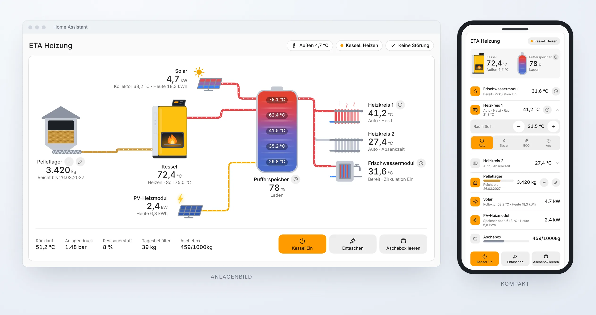
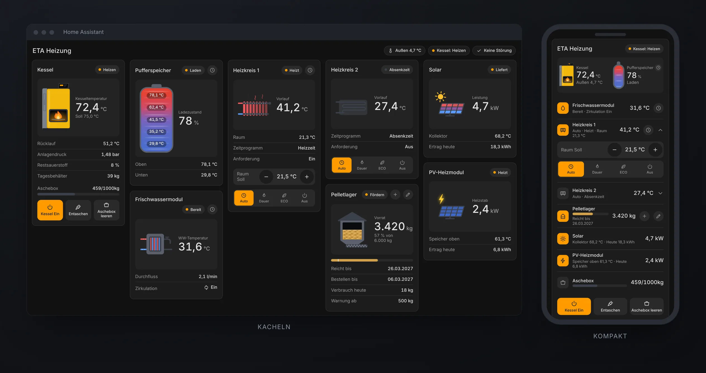
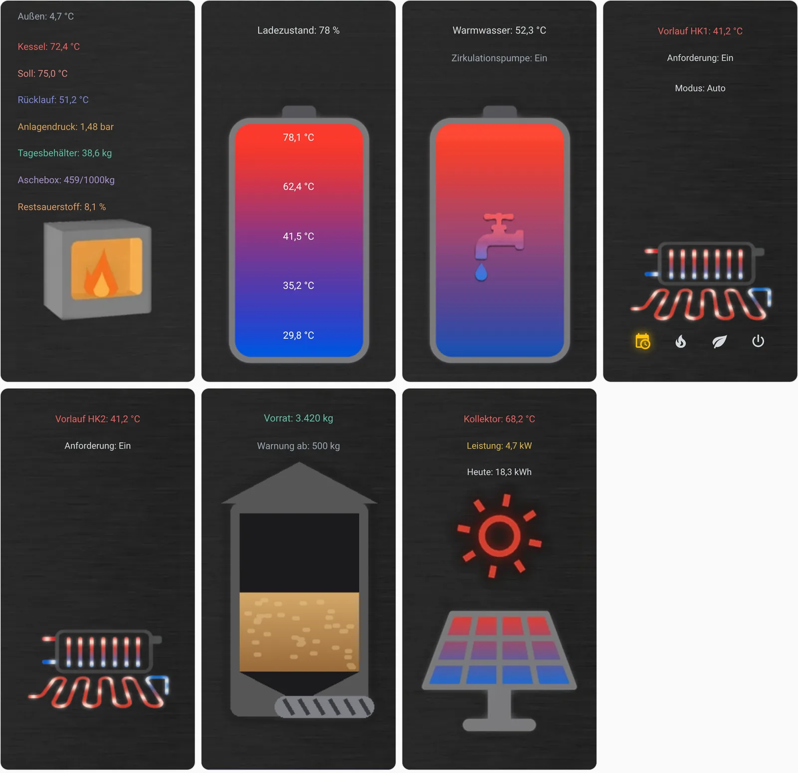
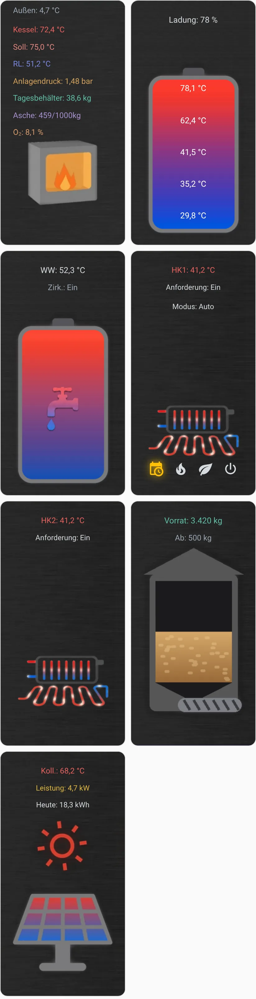
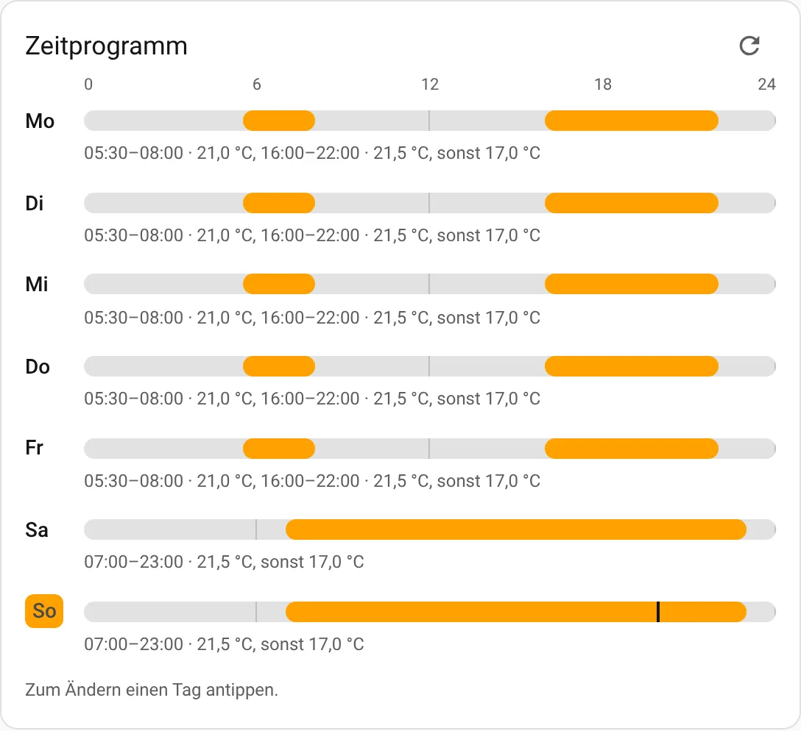
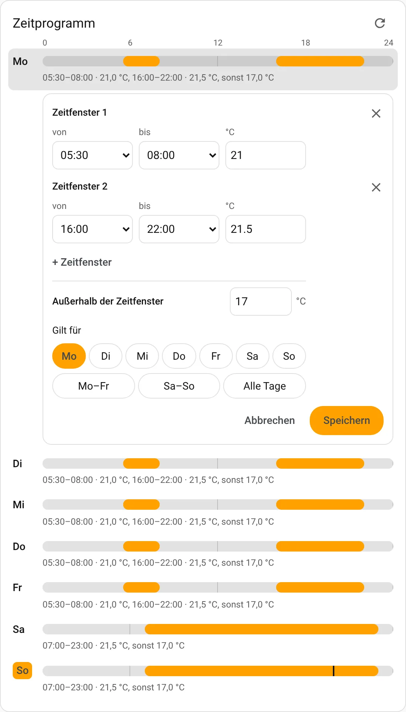

# ETA Web-Services für Home Assistant

[](https://github.com/hacs/integration)
[](https://github.com/dorsch95/ha-eta-webservices/releases)
[](LICENSE)

Bindet **ETA-Heizungen** über die eingebauten Webservices (ETAtouch) in Home Assistant ein: Pellet-, Hackgut- und Stückholzkessel samt Pufferspeichern, Warmwasser, Heizkreisen, Solaranlage, PV-Heizmodul, Pelletlager, zweitem Wärmeerzeuger, Fremdwärme und Fernleitung. Alles läuft lokal im Heimnetz, nichts geht ins Internet.

- **Einrichten ohne Adressen:** Du gibst an, was deine Anlage hat. Die Werte findet die Integration selbst im Menübaum der Heizung.
- **Fertige Dashboard-Karten:** „ETA Übersicht“ zeigt deine Anlage als Anlagenbild, als Kacheln oder kompakt, ohne YAML und mit eigenen Zeichnungen, für PC, Tablet und Handy.
- **Pelletverbrauch:** im Energie-Dashboard und je Tag, Woche und Jahr, auf Wunsch mit Kosten.
- **Verbrauchsprognose:** lernt aus deinem Verlauf und sagt, wann das Pelletlager leer ist.
- **Schalten nur auf Wunsch:** Ab Werk liest die Integration nur. Kesselschalter, Betriebsart, Thermostat, Zeitprogramm und Aschebox-Plan gibt es erst, wenn du den Schreibzugriff freigibst.

> ℹ️ Benötigt Home Assistant **2025.8** oder neuer.

**Inhalt:** [Vorbereitung](#-vorbereitung-an-der-heizung) · [Installation](#-installation) · [Einrichtung](#-einrichtung) · [Entitäten](#-entitäten) · [Dashboard-Karte](#-dashboard-karte) · [Was deine Anlage liefert](#-was-deine-anlage-liefert) · [Verbrauch und Energie-Dashboard](#-verbrauch-kosten-und-energie-dashboard) · [Prognose](#-verbrauchsprognose-und-reichweite-des-lagers) · [Schalten und Einstellen](#-schalten-und-einstellen) · [Störungen](#-störungen) · [Blueprints](#-blueprints) · [Fehlersuche](#-fehlersuche)

## 👀 So sieht es aus





Die Karte [ETA Übersicht](#neue-karte-eta-übersicht) als Anlagenbild, als Kacheln und kompakt am Handy, im hellen und im dunklen Design. Die Werte sind Beispiele.

<details>
<summary>🇬🇧 <b>English summary</b></summary>

**ETA Web-Services** reads ETA heating systems (pellet, wood chip and log boilers with buffer tanks, hot water, heating circuits, solar, PV heating module, pellet store and more) **entirely locally** via the ETAtouch webservices built into the boiler. Read-only by default; switching has to be enabled explicitly.

- Install via HACS, restart, then **Settings → Devices & services → Add integration → ETA Web-Services**. Enter the boiler's IP address (port 8080) and what your system has.
- Values are found by their names in the boiler's menu tree, not by fixed addresses. The search uses the German menu names. With another display language, enter your function block names as the display shows them.
- Entity IDs are the same in every language (e.g. `sensor.eta_heizung_kesseltemperatur`), display names are translated.
- The card **ETA Overview** needs no YAML: add it like any other card and pick tiles, a system diagram or a compact list. The card **ETA Zeitprogramm** shows and edits time programs.
- With switching enabled: boiler on/off, heating circuit modes, thermostat, time programs, ash box plan, pellet store and buffer tank volume, and locking the boiler while a wood stove heats.
- A self-learning forecast predicts tomorrow's pellet consumption and the day the pellet store runs empty.
- Tested with webservices 1.2 and one older control with webservices 1.1 (read-only there).
- Problems: open an [issue](https://github.com/dorsch95/ha-eta-webservices/issues/new/choose) and attach the **diagnostics file** (device page → *Download diagnostics*). The IP address is redacted.

</details>

---

## 🔧 Vorbereitung an der Heizung

1. Auf der Anlage läuft **Systemsoftware x.20.0 oder neuer**.
2. Die Anlage ist bei [meinETA](https://meineta.at) registriert.
3. Am Touch-Display unten links den **Werkzeugkasten** öffnen, dann **Internet & Schnittstellen → meinETA Zugang**.
4. Dort die **Webservices** aktivieren.

Zur Probe im Browser `http://<IP-der-Heizung>:8080/user/menu` öffnen: Erscheint eine XML-Seite, ist alles bereit.

Geprüft ist die Integration mit **Webservices 1.2** und an einer älteren Regelung mit **Webservices 1.1**. Die Version deiner Anlage steht in Home Assistant am Gerät *ETA Heizung*.

## 🚀 Installation

[](https://my.home-assistant.io/redirect/hacs_repository/?owner=dorsch95&repository=ha-eta-webservices&category=integration)

Oder von Hand: **HACS** öffnen, nach **ETA Web-Services** suchen, **Herunterladen**, Home Assistant neu starten.

## 🧭 Einrichtung

Unter **Einstellungen → Geräte & Dienste → Integration hinzufügen** die Integration **ETA Web-Services** wählen.

**1. Verbindung und Anlage**

| Feld | Vorgabe | Bedeutung |
|---|---|---|
| IP-Adresse, Port | `8080` | Adresse der Heizung im Heimnetz |
| Pufferspeicher | 1 | Anzahl, PufferFlex und ältere Puffer zusammen, bis 8 |
| Frischwassermodule und Warmwasserspeicher | 0 | Anzahl zusammen, bis 8 |
| Heizkreise | 0 | Anzahl, bis 4 |
| Weitere Komponenten | keine | Solaranlage, Pelletlager, PV-Heizmodul, Brenner, Fremdwärme, Fremderzeuger, Fernleitung, TWIN, siehe [Was deine Anlage liefert](#-was-deine-anlage-liefert) |
| Abfrageintervall | 30 Sekunden | 1 bis 600. Bei wenigen Sekunden die Auslastung am Display der Anlage im Auge behalten |
| Schnelle Abfrage | 3 Sekunden | 0 = aus. Liest öfter, was sich schnell ändert: alles Schaltbare, Kessel-Zustand, Raumtemperatur und das Zapfen am Frischwassermodul |
| Heizwert der Pellets | 4,8 kWh/kg | Richtwert für ENplus A1 |
| Pelletpreis | 0 | Euro je Tonne, für die Kosten. Später änderst du ihn mit `number.eta_heizung_pelletpreis` oder in der Karte |
| Störungsmeldungen auslesen | an | siehe [Störungen](#-störungen) |
| Kessel und Heizkreise schalten dürfen | aus | der Schreibzugriff, siehe [Schalten und Einstellen](#-schalten-und-einstellen) |
| Schalter „Kessel sperren“ anlegen | aus | siehe [Kessel sperren](#kessel-sperren) |
| Pelletverbrauch je Zeitraum | an | heute, Woche und Jahr |
| Pelletprognose und Reichweite des Lagers | an | siehe [Verbrauchsprognose](#-verbrauchsprognose-und-reichweite-des-lagers) |
| Wettervorhersage | automatisch | für die Prognose |

**2. Funktionsblock-Namen bestätigen**

Die Felder sind mit den Namen vorausgefüllt, die deine Anlage meldet, siehe [Funktionsblock-Namen](#funktionsblock-namen).

**3. Puffervolumen**

Der Schritt erscheint nur beim älteren Funktionsblock „Puffer“: Trag die Liter vom Typenschild oder aus den Unterlagen ein. Beim PufferFlex liest die Integration das Gesamtvolumen von der Heizung. Ändern lässt sich beides später im Feld [Puffervolumen](#puffervolumen).

**Weitere Schritte, je nach Anlage**

- **Fremderzeuger**, wenn angekreuzt, siehe [Fremderzeuger](#fremderzeuger).
- **Raumfühler** und **Zeitprogramm aus Home Assistant**, nur mit Schreibzugriff, siehe [Thermostat und Raumfühler](#thermostat-und-raumfühler-aus-home-assistant) und [Zeitprogramm aus Home Assistant](#zeitprogramm-aus-home-assistant).
- **Wer hängt woran**, nur mit mehreren Pufferspeichern oder einer Fernleitung, siehe [Neue Karte „ETA Übersicht“](#neue-karte-eta-übersicht).

Alles lässt sich später unter **Einstellungen → Geräte & Dienste → ETA Web-Services → Konfigurieren** ändern. Die IP-Adresse steht im Drei-Punkte-Menü unter **Neu konfigurieren**.

### Funktionsblock-Namen

Funktionsblöcke (FUB) lassen sich an der Steuerung umbenennen. Die Felder sind deshalb mit den Namen vorbelegt, die deine Anlage meldet. Antwortet sie nicht, stehen dort die Standardnamen:

| Komponente | Standardname |
|---|---|
| Kessel | `Kessel` |
| Pelletteil des SH TWIN | `Twin` |
| Pufferspeicher | `PufferFlex`, bei älteren Anlagen `Puffer`. Weitere heißen `PufferFlex 2` oder `Puffer 2` und so fort bis 8 |
| Frischwassermodul, Warmwasserspeicher | `FWM` oder `WW`. Weitere heißen `FWM 2` oder `WW 2` und so fort bis 8 |
| Heizkreis 1 bis 4 | `HK` (auch `HK1` oder `HK 1`), `HK2`, `HK3`, `HK4` |
| Pelletlager | `Lager` |
| Solaranlage | `Solar` |
| PV-Heizmodul | `PVM` |
| Brenner | `Brenner` |
| Fremdwärme | `F.Wärme`, auch `Fremdwärme` oder `Ofen` |
| Fernleitung | `Fernl` |
| Außentemperatur | `Sys` |

Namen von Zusatzmodulen (etwa `HK 1.1`) und selbst vergebene trägst du hier ein. Den genauen Namen zeigt das Display der Heizung als Reiter über dem Funktionsblock.

---

## 📊 Entitäten

Alle Entitäten gehören zum Gerät **ETA Heizung**.

- **Nur gewählte Komponenten** bekommen Entitäten.
- **Führt deine Anlage einen Wert nicht, zeigt der Sensor `-`.** Wenige Werte entstehen erst, wenn die Anlage sie hat, etwa die Ladepumpe.
- **Die Entitäts-IDs sind in jeder Sprache gleich**, nur der angezeigte Name ist übersetzt.
- **Was an die Heizung schreibt**, entsteht nur mit Schreibzugriff, siehe [Schalten und Einstellen](#-schalten-und-einstellen).

Gut zu wissen:

- **Pufferfühler:** PufferFlex hat 3 bis 9, der ältere Funktionsblock „Puffer“ 2 bis 5. Fühler 1 ist der oberste (Attribut `position`).
- **Puffervolumen:** ein Zahlenfeld, siehe [Puffervolumen](#puffervolumen). Mit ihm rechnen Energieinhalt und Prognose.
- **Ladezustand:** PufferFlex meldet ihn, der ältere „Puffer“ nur mit mehr als zwei Fühlern. Sonst rechnet ihn die Integration aus den Fühlern: 0 % bis 30 °C, 100 % ab 80 °C. Der Sensor trägt dann das Attribut `berechnet`.
- **Weitere Speicher:** Pufferspeicher 2 bis 8 bringen Fühler, Zustand, Ladezustand, Puffervolumen und Ladepumpe mit, Warmwasser 2 bis 8 dieselben Werte wie das erste. Den Energieinhalt gibt es nur für den ersten Puffer.
- **Pumpen** melden `Ein` oder `Aus`.
- **Warmwasser:** Der Warmwasserspeicher hat eine **Ladepumpe**, das Frischwassermodul eine **Pufferpumpe**. Ob gerade Wasser fließt, zeigen **Durchfluss** und **Drehzahl**. Mit einem zweiten Fühler unten gibt es die **Temperatur unten**.
- **Kombispeicher:** Mit einem Warmwasserbereich im Puffer gibt es **Puffer Warmwasser**.

<details>
<summary><b>Alle Entitäten im Überblick</b> (aufklappen)</summary>

| Entität | Bedeutung | Einheit |
|---|---|---|
| **Kessel** | | |
| `sensor.eta_heizung_aschebox_leeren_nach` | Aschebox Leeren nach | kg |
| `sensor.eta_heizung_aschebox_verbrauch_seit_leerung` | Aschebox Verbrauch seit Leerung | kg |
| `sensor.eta_heizung_aussentemperatur` | Außentemperatur | °C |
| `sensor.eta_heizung_kessel_solltemperatur` | Kessel Solltemperatur | °C |
| `sensor.eta_heizung_kessel_zustand` | Kessel Zustand | Text |
| `sensor.eta_heizung_kesseldruck` | Kesseldruck | bar |
| `sensor.eta_heizung_kesseltemperatur` | Kesseltemperatur | °C |
| `sensor.eta_heizung_pellet_gesamtverbrauch` | Pellet Gesamtverbrauch | kg |
| `sensor.eta_heizung_kessel_volllaststunden` | Kessel Volllaststunden | h |
| `sensor.eta_heizung_pelletverbrauch_heute` | Pelletverbrauch seit Mitternacht | kg |
| `sensor.eta_heizung_pelletverbrauch_diese_woche` | Pelletverbrauch seit Montag | kg |
| `sensor.eta_heizung_pelletverbrauch_dieses_jahr` | Pelletverbrauch seit 1. Januar | kg |
| `sensor.eta_heizung_pelletkosten_heute` … `_diese_woche`, `_dieses_jahr` | Kosten dazu, nur mit eingetragenem Pelletpreis | EUR |
| `sensor.eta_heizung_pellet_inhalt_tagesbehalter` | Pellet Inhalt Tagesbehälter | kg |
| `sensor.eta_heizung_pelletprognose_morgen` | Erwarteter Verbrauch morgen | kg |
| `sensor.eta_heizung_pelletprognose_treffsicherheit` | Wie gut die Prognose die letzten 14 Tage getroffen hat | % |
| `sensor.eta_heizung_pelletprognose_status` | Was die Prognose gerade tut („lernt noch“, „bereit“) | Text |
| `sensor.eta_heizung_restsauerstoff` | Restsauerstoff | % |
| `sensor.eta_heizung_rucklauftemperatur` | Rücklauftemperatur | °C |
| `sensor.eta_heizung_abgastemperatur` | Abgastemperatur | °C |
| `sensor.eta_heizung_verbrauch_seit_entaschung` | Verbrauch seit Entaschung | kg |
| `switch.eta_heizung_kessel` | Kessel | Schalter |
| `switch.eta_heizung_kessel_sperren` | Kessel sperren, wenn in den Einstellungen angekreuzt oder wenn ein Fremderzeuger den Kessel sperrt | Schalter |
| `button.eta_heizung_kessel_entaschen` | Kessel entaschen | Knopf |
| `datetime.eta_heizung_aschebox_leeren_um` | Aschebox leeren um, startet den Aschebox-Plan | Datum/Uhrzeit |
| `sensor.eta_heizung_aschebox_plan` | Schritt des Aschebox-Plans | Text |
| `button.eta_heizung_aschebox_plan_abbrechen` | Aschebox-Plan abbrechen | Knopf |
| **Pufferspeicher** | | |
| `sensor.eta_heizung_puffer_ladezustand` | Puffer Ladezustand | % |
| `sensor.eta_heizung_puffer_zustand` | Puffer Zustand | Text |
| `number.eta_heizung_puffervolumen` | Puffervolumen zum Einstellen | L |
| `sensor.eta_heizung_puffer_ladepumpe` | Puffer Ladepumpe | Text |
| `sensor.eta_heizung_puffer_warmwasser` | Puffer Warmwasser | °C |
| `sensor.eta_heizung_puffer_warmwasser_zustand` | Puffer Warmwasser Zustand | Text |
| `sensor.eta_heizung_puffer_energieinhalt` | Puffer Energieinhalt über 30 °C, nur mit bekanntem Puffervolumen | kWh |
| `sensor.eta_heizung_puffer_fuhler_1` … `_9` | je vorhandenem Pufferfühler einer | °C |
| **Pufferspeicher 2 bis 8** (hier für Nummer 2, die weiteren heißen genauso mit ihrer Nummer) | | |
| `sensor.eta_heizung_puffer_2_zustand` | Puffer 2 Zustand | Text |
| `sensor.eta_heizung_puffer_2_ladezustand` | Puffer 2 Ladezustand | % |
| `number.eta_heizung_puffer_2_volumen` | Puffer 2 Volumen zum Einstellen | L |
| `sensor.eta_heizung_puffer_2_ladepumpe` | Puffer 2 Ladepumpe | Text |
| `sensor.eta_heizung_puffer_2_warmwasser` | Puffer 2 Warmwasser | °C |
| `sensor.eta_heizung_puffer_2_warmwasser_zustand` | Puffer 2 Warmwasser Zustand | Text |
| `sensor.eta_heizung_puffer_2_fuhler_1` … `_9` | je vorhandenem Pufferfühler einer | °C |
| **FWM** (erstes Frischwassermodul oder erster Warmwasserspeicher) | | |
| `sensor.eta_heizung_fwm_warmwassertemperatur` | FWM Warmwassertemperatur | °C |
| `sensor.eta_heizung_fwm_warmwassertemperatur_unten` | FWM Warmwassertemperatur unten | °C |
| `sensor.eta_heizung_fwm_zirkulationspumpe` | FWM Zirkulationspumpe | Text |
| `sensor.eta_heizung_fwm_zustand` | FWM Zustand | Text |
| `sensor.eta_heizung_fwm_ladepumpe` | FWM Ladepumpe | Text |
| `sensor.eta_heizung_fwm_pufferpumpe` | FWM Pufferpumpe | Text |
| `sensor.eta_heizung_fwm_durchfluss` | FWM Durchfluss | von der Anlage |
| `sensor.eta_heizung_fwm_pufferpumpe_drehzahl` | FWM Pufferpumpe Drehzahl | von der Anlage |
| **Warmwasser 2 bis 8** (hier für Nummer 2, die weiteren heißen genauso mit ihrer Nummer) | | |
| `sensor.eta_heizung_warmwasser_2_temperatur` | Warmwasser 2 Temperatur | °C |
| `sensor.eta_heizung_warmwasser_2_temperatur_unten` | Warmwasser 2 Temperatur unten | °C |
| `sensor.eta_heizung_warmwasser_2_zirkulationspumpe` | Warmwasser 2 Zirkulationspumpe | Text |
| `sensor.eta_heizung_warmwasser_2_zustand` | Warmwasser 2 Zustand | Text |
| `sensor.eta_heizung_warmwasser_2_ladepumpe` | Warmwasser 2 Ladepumpe | Text |
| `sensor.eta_heizung_warmwasser_2_pufferpumpe` | Warmwasser 2 Pufferpumpe | Text |
| `sensor.eta_heizung_warmwasser_2_durchfluss` | Warmwasser 2 Durchfluss | von der Anlage |
| `sensor.eta_heizung_warmwasser_2_pufferpumpe_drehzahl` | Warmwasser 2 Pufferpumpe Drehzahl | von der Anlage |
| **Heizkreis 1** | | |
| `select.eta_heizung_heizkreis_1_betriebsart` | Heizkreis 1 Betriebsart | Auswahl |
| `sensor.eta_heizung_heizkreis_anforderung` | Heizkreis Anforderung | Text |
| `sensor.eta_heizung_heizkreis_vorlauftemperatur` | Heizkreis Vorlauftemperatur | °C |
| `sensor.eta_heizung_heizkreis_raumtemperatur` | Heizkreis Raumtemperatur | °C |
| `sensor.eta_heizung_heizkreis_zeitprogramm` | Heizkreis Zeitprogramm | Text |
| `climate.eta_heizung_heizkreis_1_thermostat` | Heizkreis 1 Thermostat | Thermostat |
| `select.eta_heizung_heizkreis_1_bild` | Heizkreis 1 Bild in der Karte „ETA Übersicht“: Heizkörper oder Fußbodenheizung | Auswahl |
| **Heizkreis 2** | | |
| `select.eta_heizung_heizkreis_2_betriebsart` | Heizkreis 2 Betriebsart | Auswahl |
| `sensor.eta_heizung_heizkreis_2_anforderung` | Heizkreis 2 Anforderung | Text |
| `sensor.eta_heizung_heizkreis_2_vorlauftemperatur` | Heizkreis 2 Vorlauftemperatur | °C |
| `sensor.eta_heizung_heizkreis_2_raumtemperatur` | Heizkreis 2 Raumtemperatur | °C |
| `sensor.eta_heizung_heizkreis_2_zeitprogramm` | Heizkreis 2 Zeitprogramm | Text |
| `climate.eta_heizung_heizkreis_2_thermostat` | Heizkreis 2 Thermostat | Thermostat |
| `select.eta_heizung_heizkreis_2_bild` | Heizkreis 2 Bild in der Karte „ETA Übersicht“: Heizkörper oder Fußbodenheizung | Auswahl |
| **Heizkreis 3** | | |
| `select.eta_heizung_heizkreis_3_betriebsart` | Heizkreis 3 Betriebsart | Auswahl |
| `sensor.eta_heizung_heizkreis_3_anforderung` | Heizkreis 3 Anforderung | Text |
| `sensor.eta_heizung_heizkreis_3_vorlauftemperatur` | Heizkreis 3 Vorlauftemperatur | °C |
| `sensor.eta_heizung_heizkreis_3_raumtemperatur` | Heizkreis 3 Raumtemperatur | °C |
| `sensor.eta_heizung_heizkreis_3_zeitprogramm` | Heizkreis 3 Zeitprogramm | Text |
| `climate.eta_heizung_heizkreis_3_thermostat` | Heizkreis 3 Thermostat | Thermostat |
| `select.eta_heizung_heizkreis_3_bild` | Heizkreis 3 Bild in der Karte „ETA Übersicht“: Heizkörper oder Fußbodenheizung | Auswahl |
| **Heizkreis 4** | | |
| `select.eta_heizung_heizkreis_4_betriebsart` | Heizkreis 4 Betriebsart | Auswahl |
| `sensor.eta_heizung_heizkreis_4_anforderung` | Heizkreis 4 Anforderung | Text |
| `sensor.eta_heizung_heizkreis_4_vorlauftemperatur` | Heizkreis 4 Vorlauftemperatur | °C |
| `sensor.eta_heizung_heizkreis_4_raumtemperatur` | Heizkreis 4 Raumtemperatur | °C |
| `sensor.eta_heizung_heizkreis_4_zeitprogramm` | Heizkreis 4 Zeitprogramm | Text |
| `climate.eta_heizung_heizkreis_4_thermostat` | Heizkreis 4 Thermostat | Thermostat |
| `select.eta_heizung_heizkreis_4_bild` | Heizkreis 4 Bild in der Karte „ETA Übersicht“: Heizkörper oder Fußbodenheizung | Auswahl |
| **Pelletlager** | | |
| `sensor.eta_heizung_lager_austragung` | Lager Austragung | Text |
| `sensor.eta_heizung_lager_fassungsvermogen` | Lager Fassungsvermögen | kg |
| `number.eta_heizung_lager_fassungsvermogen` | Lager Fassungsvermögen zum Einstellen | kg |
| `number.eta_heizung_lager_vorrat` | Lager Vorrat zum Einstellen, nur mit Schreibzugriff und wenn die Anlage ihn als beschreibbar meldet | kg |
| `number.eta_heizung_pelletpreis` | Pelletpreis zum Einstellen, auch ohne Pelletlager; die Attribute nennen die eingetragenen Lieferungen | EUR/t |
| `sensor.eta_heizung_lager_fullstand` | Lager Füllstand (Vorrat geteilt durch Fassungsvermögen) | % |
| `sensor.eta_heizung_lager_reicht_bis` | Tag, an dem das Lager voraussichtlich leer ist | Datum |
| `sensor.eta_heizung_lager_bestellen_bis` | Tag, an dem voraussichtlich die Warngrenze erreicht ist | Datum |
| `sensor.eta_heizung_lager_reichweite` | Tage, bis das Lager voraussichtlich leer ist | d |
| `sensor.eta_heizung_lager_vorrat` | Lager Vorrat | kg |
| `sensor.eta_heizung_lager_warngrenze` | Lager Warngrenze | kg |
| **Solar** | | |
| `sensor.eta_heizung_solar_ertrag_gestern` | Solar Ertrag gestern | kWh |
| `sensor.eta_heizung_solar_ertrag_heute` | Solar Ertrag heute | kWh |
| `sensor.eta_heizung_solar_kollektortemperatur` | Solar Kollektortemperatur | °C |
| `sensor.eta_heizung_solar_leistung` | Solar Leistung | kW |
| `sensor.eta_heizung_solar_warmemenge` | Solar Wärmemenge | kWh |
| **PV-Heizmodul** | | |
| `sensor.eta_heizung_pv_heizmodul_ertrag_gestern` | PV-Heizmodul Ertrag gestern | kWh |
| `sensor.eta_heizung_pv_heizmodul_ertrag_heute` | PV-Heizmodul Ertrag heute | kWh |
| `sensor.eta_heizung_pv_heizmodul_gesamtenergie` | PV-Heizmodul Gesamtenergie | kWh |
| `sensor.eta_heizung_pv_heizmodul_heizstab` | PV-Heizmodul Heizstab | kW |
| `sensor.eta_heizung_pv_heizmodul_temperatur_mitte` | PV-Heizmodul Temperatur Mitte | °C |
| `sensor.eta_heizung_pv_heizmodul_temperatur_oben` | PV-Heizmodul Temperatur oben | °C |
| `sensor.eta_heizung_pv_heizmodul_temperatur_unten` | PV-Heizmodul Temperatur unten | °C |
| `sensor.eta_heizung_pv_heizmodul_zustand` | PV-Heizmodul Zustand | Text |
| **Brenner** | | |
| `sensor.eta_heizung_brenner_anforderung` | Brenner Anforderung | Text |
| `sensor.eta_heizung_brenner_temperatur` | Brenner Temperatur | °C |
| `sensor.eta_heizung_brenner_leistung_soll` | Brenner Leistung Soll | kW |
| `sensor.eta_heizung_brenner_volllaststunden` | Brenner Volllaststunden | h |
| `select.eta_heizung_brenner_bild` | Brenner Bild auf den Dashboard-Karten: Gastherme, Ölkessel, Kaminofen oder Allgemein | Auswahl |
| **Fremdwärme** | | |
| `sensor.eta_heizung_fremdwarme_temperatur` | Fremdwärme Temperatur | °C |
| `sensor.eta_heizung_fremdwarme_speichertemperatur` | Fremdwärme Speichertemperatur | °C |
| `sensor.eta_heizung_fremdwarme_zustand` | Fremdwärme Zustand | Text |
| `sensor.eta_heizung_fremdwarme_ladepumpe` | Fremdwärme Ladepumpe | Text |
| `select.eta_heizung_fremdwarme_bild` | Fremdwärme Bild auf den Dashboard-Karten, dieselbe Auswahl | Auswahl |
| **Fremderzeuger** | | |
| `binary_sensor.eta_heizung_fremderzeuger_heizt` | Fremderzeuger heizt, so wie die Integration es aus Entität und Fühler bewertet | an/aus |
| `number.eta_heizung_fremderzeuger_sperrtemperatur` | Sperrtemperatur, nur mit Temperaturfühler | °C |
| `switch.eta_heizung_fremderzeuger` | eigener Ein/Aus-Schalter, nur wenn allein ein Temperaturfühler gewählt ist | Schalter |
| `select.eta_heizung_fremderzeuger_bild` | Fremderzeuger Bild in der Karte „ETA Übersicht“, dieselbe Auswahl | Auswahl |
| **Fernleitung** | | |
| `sensor.eta_heizung_fernleitung_pumpe` | Fernleitung Pumpe | Text |
| **Unabhängig von den Komponenten** | | |
| `sensor.eta_heizung_aschebox_status` | „459/1000kg“ für die Dashboard-Anzeige | Text |
| `sensor.eta_heizung_pellet_energieverbrauch_gesamt` | Gesamtverbrauch als Energie fürs Energie-Dashboard | kWh |
| `sensor.eta_heizung_aktive_fehler` | Anzahl der anstehenden Störungen | |
| `sensor.eta_heizung_komponente_*` | Marker je Komponente für die Dashboard-Karte | |
| `binary_sensor.eta_heizung_storung` | an, sobald eine Störung ansteht | |
| `binary_sensor.eta_heizung_aschebox_leeren` | an, sobald die Schwelle erreicht ist | |
| `binary_sensor.eta_heizung_pelletvorrat_niedrig` | an, sobald der Vorrat die Warngrenze erreicht | |
| `switch.eta_heizung_animationen` | bewegte oder stehende Bilder auf der Dashboard-Karte | Schalter |

</details>

### Fehlt ein Wert dauerhaft oder nur gerade?

Das sagt das Attribut `status` jedes Sensors:

| `status` | Anzeige | Bedeutung |
|---|---|---|
| `ok` | der Wert | alles in Ordnung |
| `nicht_vorhanden` | `-` | die Anlage hat den Wert nicht |
| `nicht_erreichbar` | *Nicht verfügbar* | kam bei den letzten zwei Abfragen nicht an |
| `kein_messwert` | *Unbekannt* | die Anlage zeigt nur `---`, meist ein Fühlerfehler |

---

## 📺 Dashboard-Karte

Die Integration bringt zwei Karten mit: die fertige Karte aus YAML, um die es hier zuerst geht, und die [neue Karte „ETA Übersicht“](#neue-karte-eta-übersicht), die ohne YAML auskommt. Beide zeigen nur, was du gewählt hast, und passen sich an PC, Tablet und Handy an.

<p>


</p>

### Einrichten

1. **Entwicklerwerkzeuge → Aktionen** öffnen, **ETA Web-Services: Dashboard-Karte erzeugen** ausführen und die Antwort kopieren.
2. Im Dashboard eine neue Ansicht mit dem Layout **Panel (einzelne Karte)** anlegen.
3. Eine Karte vom Typ **Manuell** einfügen und die Antwort hineinkopieren.

Nach einem Umbau der Anlage die Aktion einfach noch einmal ausführen. Ohne Aktion gibt es die universelle Karte [dashboard/eta-karte.yaml](dashboard/eta-karte.yaml), sie zeigt bis zu drei Pufferspeicher und drei Warmwasser.

### Was die Kacheln zeigen

| Kachel | Anzeige |
|---|---|
| Kessel | Messwerte, im Sichtfenster Zünden, Heizen, Glutabbrand, Entaschen und Störung. Mit Schreibzugriff die Symbole für Ein/Aus, Entaschen und Aschebox-Plan |
| Pufferspeicher | Ladezustand, die Fühler in ihrer Höhe, Ladepumpe |
| Warmwasser | Temperatur und Zirkulationspumpe |
| Heizkreis | Vorlauf, Anforderung und Betriebsart, mit Thermostat „Raum · Soll“ |
| Pelletlager | Füllstand, Austragung, Warnung unter der Warngrenze, Datum, bis wann der Vorrat reicht |
| Solar, PV-Heizmodul | leuchten, solange Leistung anliegt |
| Brenner, Fremdwärme, Fernleitung | bewegen sich, solange sie arbeiten |

Am Gerät *ETA Heizung* unter *Konfiguration* stellst du ein:

- **Animationen:** `switch.eta_heizung_animationen` aus zeigt Standbilder, etwa für ein Wandtablet.
- **Bild von Brenner, Fremdwärme und Fremderzeuger:** Gastherme, Ölkessel, Kaminofen oder Allgemein, mit `select.eta_heizung_brenner_bild`, `select.eta_heizung_fremdwarme_bild` und `select.eta_heizung_fremderzeuger_bild`.
- **Heizkörper oder Fußbodenheizung** je Heizkreis, mit `select.eta_heizung_heizkreis_1_bild` (bis `_4_`), für die Karte „ETA Übersicht“.

### Anpassen

Die Karte zeigt je nach Breite 2 (Handy), 3 (Tablet) oder 4 Spalten (ab 1040 px). Beschriftungen stehen als `prefix` im YAML. Ändere sie in allen drei Breiten.

### Neue Karte „ETA Übersicht“

**Karte hinzufügen**, Reiter **Nach Karte**, nach „ETA“ suchen. Fehlt sie nach einem Update, Home Assistant neu starten und die Seite neu laden. In den Einstellungen der Karte wählst du die **Ansicht**:

| Ansicht | Zeigt |
|---|---|
| Kacheln | je Teil der Anlage eine Kachel mit Zeichnung, Werten und Tasten |
| Anlagenbild | die Anlage als Schema: links die Erzeuger, dann Puffer und Verbraucher, dazwischen Leitungen |
| Kompakt | das Wichtigste als Liste, für das Handy oder neben anderen Karten |

- **Reihenfolge der Teile:** Teile auswählen und in die gewünschte Reihenfolge ziehen.
- **Stellen:** Mit Schreibzugriff stellst du am Heizkreis die Betriebsart und, mit Thermostat, **Raum Soll** in Schritten von 0,5 °C. Im Anlagenbild und in der Kompaktansicht klappt ein Tipp auf den Heizkreis die Tasten auf.
- **Uhr:** Hat ein Teil ein Zeitprogramm, öffnet der Knopf mit der Uhr seine Zeiten wie in der Karte [ETA Zeitprogramm](#zeitprogramm-auf-dem-dashboard). Nur mit Schreibzugriff.
- **Hinweise:** Eine Störung steht oben mit ihrer Meldung. Niedriger Vorrat und fällige Aschebox sind farbig hervorgehoben.
- **Platz:** Das Anlagenbild liegt waagerecht ab etwa 750 Pixeln Breite, mit mehreren Pufferspeichern oder einer Fernleitung ab etwa 1050. Am einfachsten ist eine eigene Ansicht mit dem Layout **Panel (einzelne Karte)**. Reicht der Platz nicht, wird das Bild zur Liste.
- **Wer hängt woran:** Die Webservices verraten nicht, welches Teil welches versorgt. Die Karte nimmt an: Der Kessel lädt den ersten Pufferspeicher, weitere hängen hintereinander, Heizkreise und Warmwasser am letzten. Mit mehreren Pufferspeichern oder einer Fernleitung fragt **Konfigurieren** im letzten Schritt je Teil, woher es seine Wärme bekommt.

---

## 🪵 Was deine Anlage liefert

Welche Werte ankommen, entscheidet die Anlage.

- **Pelletkessel** führen einen Gesamtverbrauch. Daraus entstehen Energiewert, Verbrauch je Zeitraum und Prognose. **Hackgut und Stückholz** messen ihren Verbrauch nicht.
- **TWIN:** für einen Stückholzkessel mit angebautem Pelletteil (SH TWIN). Dann erscheinen Pelletverbrauch, Tagesbehälter und Aschebox wie bei einem Pelletkessel.
- **Abgastemperatur:** nur, wenn der Kessel einen Abgasfühler im Menübaum führt.
- **Pelletlager:** Vorrat, Warngrenze und Fassungsvermögen kommen von der Anlage, siehe [Pelletlager](#pelletlager-vorrat-fassungsvermögen-preis-und-lieferung).
- **Ältere Regelungen** (Webservices 1.1): Die Integration liest Pelletkessel, älteren Puffer, Warmwasserspeicher, Heizkreise, Pelletlager, Außentemperatur und Solaranlage. Den Ladezustand des Puffers rechnet sie selbst, das Fassungsvermögen des Lagers trägst du ein. Schalten und Einstellen geht erst ab Webservices 1.2.
- **Solaranlage:** Die Kollektortemperatur gibt es immer, Leistung, Wärmemenge und Erträge nur mit Wärmemengenmessung. Fürs Energie-Dashboard eignet sich die Wärmemenge nicht.
- **PV-Heizmodul (PVM):** heizt mit überschüssigem PV-Strom ins Wasser. `sensor.eta_heizung_pv_heizmodul_gesamtenergie` gehört im Energie-Dashboard unter **Einzelne Geräte**. An einer echten Anlage ist das PV-Heizmodul noch nicht geprüft.
- **Brenner:** ein zweiter Wärmeerzeuger wie Gastherme, Ölkessel oder Wärmepumpe, den die ETA-Regelung freigibt oder sperrt. Ob er wirklich brennt, meldet er nicht zurück.
- **Fremdwärme:** ein Ofen an der ETA-Regelung, etwa ein Kaminofen mit Wassertasche. Gelesen werden Temperatur, Speichertemperatur, Zustand und Ladepumpe.
- **Fernleitung:** die Leitung zu einem Nebengebäude. Gelesen wird, ob die Fernpumpe läuft.
- **Fremdwärme oder Fremderzeuger?** Steht dein Ofen am Display der Heizung als eigener Block (ab Werk `F.Wärme`), nimm **Fremdwärme**. Steht er dort nicht, nimm **Fremderzeuger**.

| | Fremdwärme | Fremderzeuger |
|---|---|---|
| Am Display der Heizung | eigener Block, ab Werk `F.Wärme` | steht dort nicht |
| Wer merkt, dass der Ofen heizt | die ETA-Regelung, über ihren Fühler | Home Assistant, über eine Entität oder einen Temperaturfühler |
| Was dann passiert | die Regelung lädt selbst in den Puffer | Home Assistant kann den Kessel sperren, siehe [Fremderzeuger](#fremderzeuger) |

Fehlt bei dir etwas, hilft ein [Issue](https://github.com/dorsch95/ha-eta-webservices/issues/new/choose) mit der Diagnose-Datei.

---

## 📈 Verbrauch, Kosten und Energie-Dashboard

Für Kessel mit Gesamtverbrauch, also Pellets und SH TWIN.

**Je Zeitraum:** Die Integration zählt, was **heute**, **diese Woche** (ab Montag) und **dieses Jahr** verbrannt wurde, in kg und mit Pelletpreis auch in Euro. Gezählt wird ab dem Einrichten.

**Energie-Dashboard:** `sensor.eta_heizung_pellet_energieverbrauch_gesamt` ist der Gesamtverbrauch mal dem Heizwert, in kWh. Du wählst ihn unter **Einstellungen → Dashboards → Energie → Gasverbrauch hinzufügen**.

> ⚠️ Ändere den Heizwert möglichst nur beim Einrichten. Bei einer späteren Änderung springt der Wert, und der Gesamtverbrauch fällt einmalig zu hoch aus.

---

## 🔮 Verbrauchsprognose und Reichweite des Lagers

Die Integration lernt aus deinem Verlauf, wie viel dein Haus bei welcher Außentemperatur verbrennt, und rechnet damit voraus.

| Entität | Bedeutung |
|---|---|
| `sensor.eta_heizung_pelletprognose_morgen` | erwarteter Verbrauch morgen in kg |
| `sensor.eta_heizung_pelletprognose_treffsicherheit` | wie gut die Prognose die letzten 14 Tage getroffen hat |
| `sensor.eta_heizung_pelletprognose_status` | „lernt noch (…)“ oder „bereit“ |
| `sensor.eta_heizung_lager_reicht_bis` | Tag, an dem das Lager leer ist, mit *frühestens* und *spätestens* |
| `sensor.eta_heizung_lager_bestellen_bis` | Tag, an dem die Warngrenze erreicht ist |
| `sensor.eta_heizung_lager_reichweite` | Tage, die der Vorrat noch reicht |

- **Was sie braucht:** einen Kessel mit Gesamtverbrauch, den Recorder von Home Assistant und 14 vollständige Tage, davon 7 mit höchstens 12 °C. Bis dahin steht im Status, worauf sie wartet. Die drei Lager-Werte gibt es nur mit Pelletlager.
- **Wettervorhersage:** Wähle unter **Konfigurieren** eine Wetter-Entität. Gibt es genau eine, nimmt die Prognose sie von selbst. Ohne Vorhersage rechnet sie mit dem langjährigen Mittel.
- **Pufferspeicher:** Mit bekanntem [Puffervolumen](#puffervolumen) rechnet sie heraus, was der Puffer über Mitternacht mitnimmt. Beim PufferFlex steht es an der Heizung ab Werk auf 1000 l - prüf, ob das zu deinem Puffer passt.
- **Genauigkeit:** In einer Simulation mit 120 Häusern lag der geschätzte Leer-Tag ohne Wettervorhersage im Mittel 3 Tage daneben, wenn das Lager in 30 Tagen leer war, und 6 Tage bei 120 Tagen.

Die Prognose rechnet nur in Home Assistant und schreibt nichts in die Heizung.

---

## 🔌 Schalten und Einstellen

Ab Werk liest die Integration nur. Was in die Heizung schreibt, entsteht erst, wenn du beim Einrichten oder unter **Konfigurieren** *Kessel und Heizkreise schalten dürfen* einschaltest. Geschrieben wird nur, was die Anlage selbst als beschreibbar meldet. Dafür braucht sie Webservices **1.2** oder neuer.

> ⚠️ Schalten greift direkt in die Heizung ein. Im Winter einen Heizkreis oder den Kessel per Automation abzuschalten kann Räume auskühlen lassen. Für den Frostschutz bleibt die Anlage selbst zuständig.

### Kessel ein und aus

`switch.eta_heizung_kessel` bedient die Ein/Aus-Taste des Kessels. Heizkreise haben keinen eigenen Schalter, dort ist „Aus“ eine Betriebsart.

### Fremderzeuger

Ein Ofen oder eine andere Wärmequelle **ohne Anschluss an die ETA-Regelung**, etwa ein Kaminofen mit eigener Regelung. Home Assistant erkennt, ob er heizt, und kann solange den Kessel sperren. Steht dein Ofen am Display als eigener Block, nimm stattdessen Fremdwärme, siehe [Was deine Anlage liefert](#-was-deine-anlage-liefert).

**Einrichten:** Unter **Weitere Komponenten** den **Fremderzeuger** ankreuzen. Im Schritt **Fremderzeuger** gibst du an, woran Home Assistant erkennt, dass er heizt:

| Du gibst an | Er gilt als heizend | Gesperrt wird |
|---|---|---|
| nur eine **Entität** (Schalter, Helfer oder Binärsensor) | solange sie an ist | nach der Wartezeit „Sperren nach“ (ab Werk 1 Minute) |
| nur einen **Temperaturfühler** | sobald die Sperrtemperatur erreicht ist | sofort |
| **beides** | wenn die Entität an ist und die Sperrtemperatur erreicht ist | sofort |

Mit Schreibzugriff kreuzt du im Feld **Sperren, solange er heizt** den Kessel an. Ab Werk sperrt er nichts und wird nur angezeigt. Die **Sperrtemperatur** (ab Werk 60 °C) stellst du in der Karte unter **Sperrt ab** oder mit `number.eta_heizung_fremderzeuger_sperrtemperatur`. Als aus gilt er erst wieder 5 °C darunter.

**Was dann passiert:**

- Heizt er, schaltet Home Assistant den Kessel über dessen Ein/Aus-Taste aus. Heizt er die Wartezeit „Freigeben nach“ lang nicht mehr (ab Werk 5 Minuten), schaltet es ihn wieder ein. Ein Kessel, den du selbst ausgeschaltet hattest, bleibt aus.
- Fällt die Entität oder der Fühler aus, wird der Kessel nach derselben Wartezeit freigegeben.
- Nimmt die Heizung das Sperren oder Freigeben nicht an, versucht Home Assistant es jede Minute wieder. Nach fünf Fehlversuchen beim Freigeben erscheint eine Meldung.
- Schaltest du den gesperrten Kessel von Hand ein, bleibt er an, bis der Fremderzeuger das nächste Mal anfängt zu heizen - oder bis Home Assistant neu startet, während er noch heizt.
- Wählst du den Fremderzeuger ab, während der Kessel gesperrt ist, schaltet Home Assistant ihn wieder ein und meldet das.

In der Karte [ETA Übersicht](#neue-karte-eta-übersicht) hat er eine eigene Kachel. Hast du nur einen Temperaturfühler angegeben, gibt es `switch.eta_heizung_fremderzeuger`: Aus heißt, Home Assistant beachtet den Ofen nicht. Für eigene Automationen sagt `binary_sensor.eta_heizung_fremderzeuger_heizt`, ob er heizt.

> ⚠️ Fällt Home Assistant aus, während der Kessel gesperrt ist, bleibt er aus. Im Notfall schaltest du ihn am Display der Heizung wieder ein.

### Kessel sperren

`switch.eta_heizung_kessel_sperren` lässt den Kessel pausieren, etwa per Automation. Du legst ihn unter **Konfigurieren** mit **Schalter „Kessel sperren“ anlegen** an, er braucht den Schreibzugriff. Mit der Komponente [Fremderzeuger](#fremderzeuger) entsteht er von selbst.

- **Ein** schaltet den Kessel über seine Ein/Aus-Taste aus.
- **Aus** schaltet ihn wieder ein, aber nur, wenn der Schalter ihn ausgeschaltet hat. War der Kessel beim Sperren schon aus, bleibt er aus.
- Schaltest du den gesperrten Kessel selbst wieder ein, ist die Sperre aufgehoben.

Was der Schalter sich gemerkt hat, übersteht einen Neustart. Nimmst du das Häkchen weg, während der Kessel gesperrt ist, schaltet Home Assistant ihn wieder ein und meldet das. Der Blueprint [Kessel sperren](#-blueprints) verbindet den Schalter mit einer Entität.

> ⚠️ Der Kessel bleibt aus, bis der Schalter wieder aus ist - auch wenn Home Assistant in der Zeit ausfällt. **Im Notfall schaltest du den Kessel am Display der Heizung wieder ein.** An der Heizung steht er nur als ausgeschaltet da.

### Entaschen und Aschebox leeren

Findet die Integration die **Entaschentaste** (am Display unter *Sonstiges*), gibt es:

- **`button.eta_heizung_kessel_entaschen`** drückt die Entaschentaste. Der Kessel geht in den Glutabbrand und entascht danach.
- **Den Aschebox-Plan:** Die Aschebox darf nur bei ausgeschaltetem Kessel abgenommen werden. Unter `datetime.eta_heizung_aschebox_leeren_um` stellst du ein, wann du leeren willst. Home Assistant
  1. schaltet den Kessel rechtzeitig aus - beim ersten Mal 30 Minuten vorher, danach nach der gemessenen Dauer plus 5 Minuten,
  2. drückt die Entaschentaste, sobald der Kessel *Bereit* oder *Ausgeschaltet* meldet,
  3. meldet, wenn die Aschebox geleert werden kann,
  4. schaltet den Kessel wieder ein, sobald die Box wieder eingesetzt ist - nach 2 Stunden auch ohne Leeren.

`sensor.eta_heizung_aschebox_plan` zeigt den Schritt, `button.eta_heizung_aschebox_plan_abbrechen` bricht ab. Schaltest du den Kessel selbst ein, endet der Plan. Er übersteht einen Neustart von Home Assistant. Ein gesperrter Kessel bleibt am Ende des Plans aus, bis die Sperre endet. Jeder Schritt löst das Ereignis `eta_heating_ws_aschebox` aus (mit `phase` und `nachricht`), etwa für eine Nachricht aufs Handy.

### Pelletlager: Vorrat, Fassungsvermögen, Preis und Lieferung

In der Karte [ETA Übersicht](#neue-karte-eta-übersicht) hat das Pelletlager zwei Knöpfe: **Plus** trägt eine Lieferung ein (Datum, Menge, Preis je Tonne) und erhöht den Vorrat an der Heizung. **Stift** stellt Vorrat, Fassungsvermögen und Pelletpreis. Ohne Karte:

| | Was | Wohin |
|---|---|---|
| `number.eta_heizung_lager_vorrat` | Vorrat in kg | an die Anlage. Nur mit Schreibzugriff und wenn die Anlage den Vorrat als beschreibbar meldet |
| `number.eta_heizung_lager_fassungsvermogen` | Fassungsvermögen in kg | an die Anlage, sonst nur in Home Assistant |
| `number.eta_heizung_pelletpreis` | Preis in Euro je Tonne | nur in Home Assistant. 0 schaltet die Kosten ab |
| Aktion `eta_heating_ws.lieferung_eintragen` | `datum`, `menge` in kg, `preis` in Euro je Tonne | merkt sich die Lieferung, übernimmt den Preis, erhöht den Vorrat an der Anlage |

Die letzten 20 Lieferungen stehen im Attribut `lieferungen` von `number.eta_heizung_pelletpreis`. Lässt sich der Vorrat nicht schreiben, wird die Lieferung gemerkt und der Preis übernommen. Den Vorrat stellst du dann am Display.

Das **Fassungsvermögen** geht an die Anlage (*Lager → Vorrat → Maximaler Vorrat*), wenn der Schreibzugriff frei ist und sie den Wert als beschreibbar meldet. Sonst merkt es sich Home Assistant, 0 verwirft deinen Wert wieder. Wohin das Feld schreibt, zeigt sein Attribut `gespeichert`.

### Puffervolumen

Jeder Pufferspeicher hat am Gerät *ETA Heizung* unter **Konfiguration** das Zahlenfeld **Puffervolumen** (`number.eta_heizung_puffervolumen`, weitere Puffer `number.eta_heizung_puffer_2_volumen` usw.). Mit diesen Litern rechnen Energieinhalt und Prognose.

| Puffer | Das Feld zeigt | Eine Änderung geht |
|---|---|---|
| PufferFlex, mit Schreibzugriff | das Gesamtvolumen der Heizung (*PufferFlex → Einstellungen → Gesamtvolumen*, ab Werk 1000 l) | an die Heizung, ab 50 l |
| PufferFlex, ohne Schreibzugriff | das Gesamtvolumen der Heizung | nur an Home Assistant. 0 nimmt wieder den Wert der Heizung |
| Älterer „Puffer“ | die Liter aus der Einrichtung | nur an Home Assistant. 0 heißt unbekannt, dann gibt es keinen Energieinhalt |

> ⚠️ Mit Schreibzugriff ändert das Feld beim PufferFlex das Gesamtvolumen **an der Heizung**. Home Assistant meldet jede solche Änderung mit dem Wert von vorher.

Wohin das Feld schreibt, zeigt sein Attribut `gespeichert`.

### Betriebsart je Heizkreis

Findet die Integration am Heizkreis die Tasten **Auto**, **Heizen** und **Absenken** sowie seine Ein/Aus-Taste, entsteht `select.eta_heizung_heizkreis_1_betriebsart` (bis `_4_`):

| Auswahl | Was geschieht | Wert in Automatisierungen |
|---|---|---|
| Auto | Der Heizkreis folgt seinem Zeitprogramm | `automatik` |
| Dauer | dauerhaft Heizbetrieb | `heizen` |
| ECO | dauerhaft Absenkbetrieb | `absenken` |
| Aus | Der Heizkreis wird über seine Ein/Aus-Taste abgeschaltet | `aus` |

Ob das Zeitprogramm gerade eine Heizzeit oder eine Absenkzeit hat, zeigt `sensor.eta_heizung_heizkreis_zeitprogramm` (bis `_4_`) als **Tag** oder **Absenk**, in Automatisierungen `heizzeit` oder `absenkzeit`.

### Thermostat und Raumfühler aus Home Assistant

Ist ein Heizkreis im ETA-Assistenten mit **„Raumfühler ext. Schnittstelle“** eingerichtet, kann Home Assistant der Anlage die Raumtemperatur liefern, etwa von einem Zigbee-Thermometer. Dann entsteht:

- **`climate.eta_heizung_heizkreis_1_thermostat`** (bis `_4_`): Istwert ist „Raum“, Sollwert „Raum Soll“ von 10 bis 30 °C in halben Grad. Stellst du ihn um, ändert das wie am Display die Temperatur der Heizzeiten für alle Tage.
- **Der Schritt „Raumfühler aus Home Assistant“** unter **Konfigurieren**: je Heizkreis ein Thermometer und die **Zeitüberwachung** (1 bis 60 Minuten).

Die Integration schreibt den Wert des Thermometers alle 30 Sekunden und bei jeder Änderung in die Anlage.

- **Zeitüberwachung:** Kommt in dieser Zeit kein neuer Wert, verwirft die Anlage den alten und meldet „Raumfühler: Keine Verbindung“. Ab Werk steht sie auf 1 Minute. **10 Minuten** überbrücken einen Neustart von Home Assistant.
- **Thermometer nicht verfügbar:** Die Integration schreibt nichts.
- **Thermometer mit leerer Batterie:** Hat es sich **12 Stunden** nicht gemeldet, erscheint ein Hinweis unter **Einstellungen → Reparaturen**.

### Zeitprogramm auf dem Dashboard

Die Karte **ETA Zeitprogramm** zeigt die Heizzeiten jedes Heizkreises als Wochenbalken, und du änderst sie direkt dort.

<p>


</p>

1. **Dashboard bearbeiten → Karte hinzufügen**, Reiter **Nach Karte**, **ETA Zeitprogramm** wählen.
2. **Einen Tag antippen.** Darunter öffnen sich seine Zeitfenster mit Beginn, Ende und Temperatur, dazu die Temperatur außerhalb der Zeitfenster (die Absenkung).
3. Unter **Gilt für** weitere Tage wählen, etwa **Mo–Fr**.
4. **Speichern.** Die Integration schreibt nur, was sich ändert, und liest es zur Kontrolle nach.

Die Heizung erlaubt höchstens 3 Zeitfenster je Tag, Zeiten in Viertelstunden und Temperaturen von 10 bis 30 °C. **⟳** liest das Programm neu von der Heizung. Folgt ein Heizkreis einem Zeitplan aus Home Assistant (nächster Abschnitt), zeigt die Karte sein Programm nur an. Unter **Karte bearbeiten → Anzeigen** lassen sich weitere Zeitprogramme einblenden:

| Anzeigen | Was es ist | Temperatur |
|---|---|---|
| Heizzeiten | Zeitprogramm der Heizkreise, ab Werk gewählt | 10 bis 30 °C |
| Ladezeiten Puffer | wann der Puffer geladen wird | keine |
| Warmwasser | Ladezeiten des Warmwasserspeichers, Warmwasserbereich eines Kombi-Puffers, Bereitschaftszeiten des Frischwassermoduls | Frischwassermodul 0 bis 80 °C, sonst im Bereich, den die Heizung meldet |
| Zirkulation | wann die Zirkulationspumpe läuft | keine |

> ⚠️ Beim Warmwasser muss über 60 °C **zwingend ein Verbrühschutz** verbaut sein. Beim Frischwassermodul ist unter 40 °C keine gleichmäßige Regelung mehr gewährleistet. Die Karte weist vor dem Speichern darauf hin.

### Zeitprogramm aus Home Assistant

Statt über die Karte kann das Zeitprogramm eines Heizkreises einem **Zeitplan** aus Home Assistant folgen. Lege unter **Einstellungen → Geräte & Dienste → Helfer** einen Zeitplan an und wähle ihn unter **Konfigurieren** im Schritt **„Zeitprogramm aus Home Assistant“** beim Heizkreis aus. Jeder Block wird ein Zeitfenster der Heizung, außerhalb gilt die Absenkung.

- **Beim ersten Mal fragt die Integration nach:** Weicht der Zeitplan von der Heizung ab, zeigt sie unter **Einstellungen → Reparaturen** die geplanten Änderungen und schreibt erst mit **Absenden**.
- **Danach** schreibt sie ohne Rückfrage, sobald du den Zeitplan änderst, und beim Start. Was jemand am Display ändert, gilt bis dahin.
- **Grenzen der Heizung:** höchstens 3 Zeitfenster je Tag, Zeiten in Viertelstunden. Hat ein Tag mehr Blöcke, bleibt er, wie er ist, und unter **Reparaturen** erscheint ein Hinweis.
- **Temperatur:** Sie wird nur geschrieben, wenn ein Block sie in seinen zusätzlichen Daten mitbringt (`temperatur: 21`). Die Absenktemperatur stellst du an der Heizung ein.
- **Nie geschrieben** wird ein Zeitplan ganz ohne Blöcke. Dafür gibt es die Betriebsart *ECO*.

Das Zeitprogramm wirkt nur in der Betriebsart *Auto*. Stehen Temperaturen im Zeitplan, überschreibt der nächste Abgleich, was du am Thermostat verstellt hast.

---

## 🚨 Störungen

`sensor.eta_heizung_aktive_fehler` zeigt die Anzahl der anstehenden Störungen, die Meldungen stehen in den Attributen:

```yaml
fehler:
  - funktionsblock: Kessel
    meldung: Wasserdruck zu niedrig 1,20 bar
    prioritaet: Error
    zeit: '2026-09-14 11:02:31'
    hinweis: Heizungswasser nachfüllen!
```

Für Automatisierungen genügt meist `binary_sensor.eta_heizung_storung`. Fertig verpackt gibt es das als Blueprint **Störung melden**.

---

## 🧩 Blueprints

**Importieren** öffnet Home Assistant und übernimmt den Blueprint. Danach wählst du ihn unter **Einstellungen → Automatisierungen & Szenen → Blueprints** aus.

| Blueprint | Wofür | |
|---|---|---|
| **Störung melden** | Nachricht mit dem Klartext der Meldung, sobald eine Störung ansteht | [](https://my.home-assistant.io/redirect/blueprint_import/?blueprint_url=https%3A%2F%2Fgithub.com%2Fdorsch95%2Fha-eta-webservices%2Fblob%2Fmain%2Fblueprints%2Fautomation%2Feta_webservices%2Fstoerung_melden.yaml) |
| **Aschebox leeren** | Erinnerung, sobald die Schwelle der Anlage erreicht ist | [](https://my.home-assistant.io/redirect/blueprint_import/?blueprint_url=https%3A%2F%2Fgithub.com%2Fdorsch95%2Fha-eta-webservices%2Fblob%2Fmain%2Fblueprints%2Fautomation%2Feta_webservices%2Faschebox_leeren.yaml) |
| **Pelletvorrat niedrig** | Erinnerung zum Bestellen, sobald der Vorrat die Warngrenze der Anlage erreicht | [](https://my.home-assistant.io/redirect/blueprint_import/?blueprint_url=https%3A%2F%2Fgithub.com%2Fdorsch95%2Fha-eta-webservices%2Fblob%2Fmain%2Fblueprints%2Fautomation%2Feta_webservices%2Fpelletvorrat_melden.yaml) |
| **Heizkreis auf ECO bei offenem Fenster** | Setzt den Heizkreis auf ECO, solange ein Fenster offen steht, und stellt danach die Betriebsart von vorher wieder her. Braucht den Schreibzugriff | [](https://my.home-assistant.io/redirect/blueprint_import/?blueprint_url=https%3A%2F%2Fgithub.com%2Fdorsch95%2Fha-eta-webservices%2Fblob%2Fmain%2Fblueprints%2Fautomation%2Feta_webservices%2Fheizkreis_absenken.yaml) |
| **Kessel sperren** | Sperrt den Kessel, solange eine andere Wärmequelle heizt, und gibt ihn danach wieder frei. Braucht den Schalter [Kessel sperren](#kessel-sperren) | [](https://my.home-assistant.io/redirect/blueprint_import/?blueprint_url=https%3A%2F%2Fgithub.com%2Fdorsch95%2Fha-eta-webservices%2Fblob%2Fmain%2Fblueprints%2Fautomation%2Feta_webservices%2Fkessel_sperren.yaml) |

Die Dateien liegen unter [`blueprints/automation/eta_webservices`](blueprints/automation/eta_webservices). Ohne Zugang zu GitHub kopierst du sie von Hand nach `config/blueprints/automation/eta_webservices/` und startest Home Assistant neu.

---

## 🩺 Fehlersuche

Die Integration findet die Werte über die **Namen** im Menübaum deiner Anlage, nicht über feste Adressen. Fehlt etwas, ist es an deiner Anlage meist nicht verbaut.

**Eine ganze Komponente ohne Werte** meldet Home Assistant unter **Einstellungen → Reparaturen**. Der Hinweis führt zu **Konfigurieren**, wo du den tatsächlichen Funktionsblock-Namen einträgst.

**Ein einzelner Wert fehlt oder stimmt nicht:** Lade die Diagnose-Datei herunter (**Einstellungen → Geräte & Dienste → ETA Web-Services → Gerät „ETA Heizung“ → Diagnose herunterladen**) und häng sie an ein [Issue](https://github.com/dorsch95/ha-eta-webservices/issues/new/choose). Sie enthält den vollständigen Menübaum, die IP-Adresse ist geschwärzt.

**Ein Schalter erscheint nicht,** obwohl der Schreibzugriff freigegeben ist: Das Debug-Protokoll nennt den Grund. Dafür in der `configuration.yaml`:

```yaml
logger:
  logs:
    custom_components.eta_heating_ws: debug
```

**Die Integration lässt sich gar nicht einrichten:** [`tools/eta_bericht.py`](tools/eta_bericht.py) fragt die Anlage direkt. Nötig ist nur Python auf einem Rechner im selben Netz:

```bash
python3 eta_bericht.py <IP-der-Heizung>
```

Heraus kommt `eta_bericht.txt` mit dem vollständigen Menübaum, die IP-Adresse ebenfalls geschwärzt. Das Skript liest nur.

---

## 🧪 Entwicklung

```bash
python -m venv .venv && source .venv/bin/activate
pip install -r requirements_test.txt
pytest
```

Dieselben Tests laufen bei jedem Push in GitHub Actions, zusammen mit `hassfest` und der HACS-Validierung.

---

⭐ Gefällt dir die Integration? Ein Stern auf GitHub hilft anderen ETA-Besitzern, sie zu finden.

## 📄 Lizenz

MIT, siehe [LICENSE](LICENSE).
